## What Is Economics?

- “Economics is the study of mankind in the ordinary business of life” — Alfred Marshal
- “Economics deals with all human action” — Ludwig von Mises
- “The study of how society manages its scarce resources” — Gregory Mankiw
- “People respond to incentives” — Steve Landsburg
- “Economics shows how little we know about what we try to design” — FA Hayek

- **Unifying idea:** Economics studies **choices under scarcity**.

## Micro, Macro and Models

- **Microeconomics**: Decisions of individuals and firms  
- **Macroeconomics**: Economy-wide outcomes (growth, inflation, unemployment)

- Economics uses **models**: simplified maps of reality
  - Focus on incentives, constraints, and trade-offs
  - “Often wrong, but sometimes useful”

## Scarcity & Wants vs. Needs

- **Economics**: How society allocates **scarce** resources

- **Scarcity**:
  - Limited resources, unlimited wants
  - Resources: land, labor, capital, entrepreneurship (and time)
  
- **Wants vs. Needs**
  - Needs are relatively objective (e.g. daily nutritional requirements)
  - Wants are more subjective and context-dependent (e.g. air conditioning)
  - We may eliminate poverty (objective), but we will never eliminate scarcity
  
## Scarcity requires choice

- Scarcity ⇒ **choice**

- Three core questions:
  - What to produce?
  - How to produce it?
  - For whom to produce?
  
## Scarcity is not the same as poverty

<iframe src="https://ourworldindata.org/grapher/share-of-population-living-in-extreme-poverty?tab=line"
        data-external="1"
        loading="lazy"
        style="width: 100%; height: 600px; border: 0px none;"
        allow="web-share; clipboard-write"></iframe>

## Scarcity is not the same as poverty

<iframe src="https://ourworldindata.org/explorers/poverty-explorer?tab=line&Indicator=Share+in+poverty&Poverty+line=%243+per+day%3A+International+Poverty+Line&Household+survey+data+type=Show+data+from+both+income+and+consumption+surveys&Show+breaks+between+less+comparable+surveys=false&country=~OWID_WRL&hideControls=false"
        data-external="1"
        loading="lazy"
        style="width: 100%; height: 600px; border: 0px none;"
        allow="web-share; clipboard-write"></iframe>

## Scarcity Creates Opportunity Costs

- Using resources for one good means **less of another**

- Every choice implies a forgone alternative  
  - “There are no solutions, only trade-offs”

- **Opportunity cost**:
  - The **highest-valued** alternative given up

## Scarcity Creates Opportunity Costs

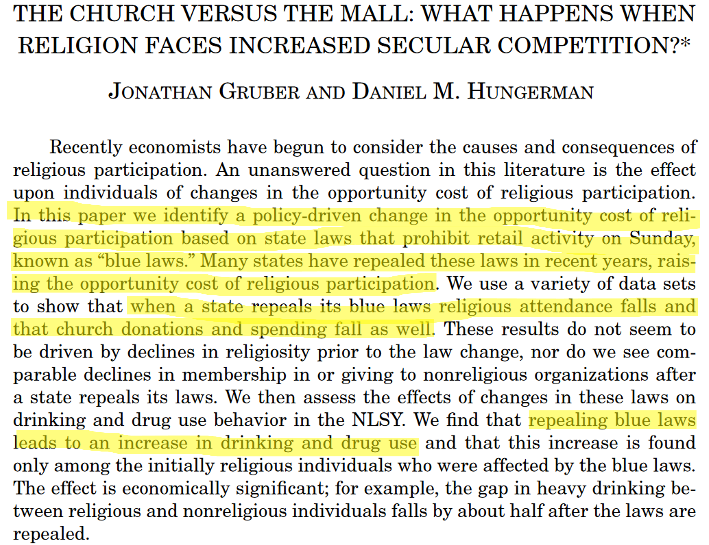

@gruber2008church

## Core Tenets of Economics

- **Purposeful choice**
  - People choose options that best achieve their goals
  - Preferences are **revealed by choices**
  - "Talk is cheap"

- **Incentives matter**
  - Behavior responds predictably to incentives
  - Free shipping at $35 → carts bunch at $35
  - Surge pricing → more drivers

## Incentives Matter

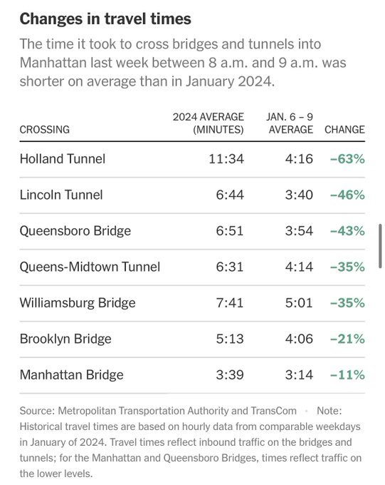

## Core Tenets of Economics

- **Think at the margin**
  - Decisions depend on **marginal benefits vs. marginal costs**
  - Marginal cost of one class = opportunity cost + travel/time
  - Average cost ≠ marginal cost

- **Sunk costs are irrelevant**
  - Past costs should not affect current decisions
  
## Sunk Cost Fallacy Examples

- “I can’t move yet — my lease isn’t over”
- “I can’t drop the class after all this work”
- “I’ve waited too long to hang up”
- “I’ll hold the stock until I break even”
- “Canceling now would waste the money”

## Sunk Cost Fallacy Examples

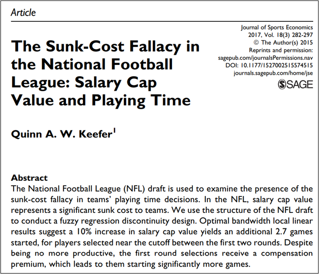

@keefer2017sunk

## Core Tenets of Economics

- **Beware of Secondary Effects**
  - Policies change behavior in unintended ways
    - Plastic bag bans → substitution to worse alternatives
    - Mandatory insurance → less careful driving
    - Capped liability → riskier firm behavior

## Unintended Consequences

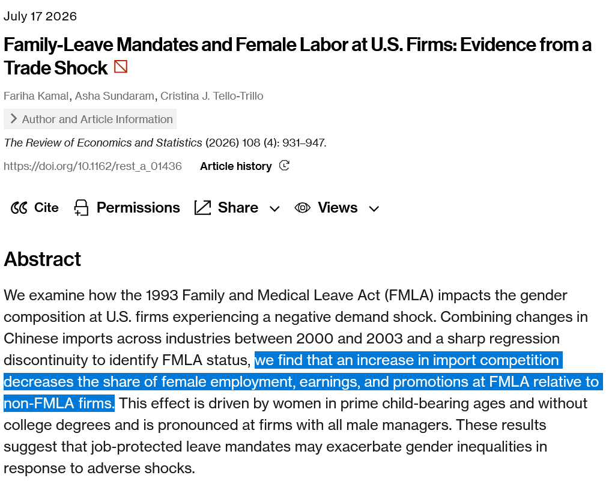

## The Wealth of Nations

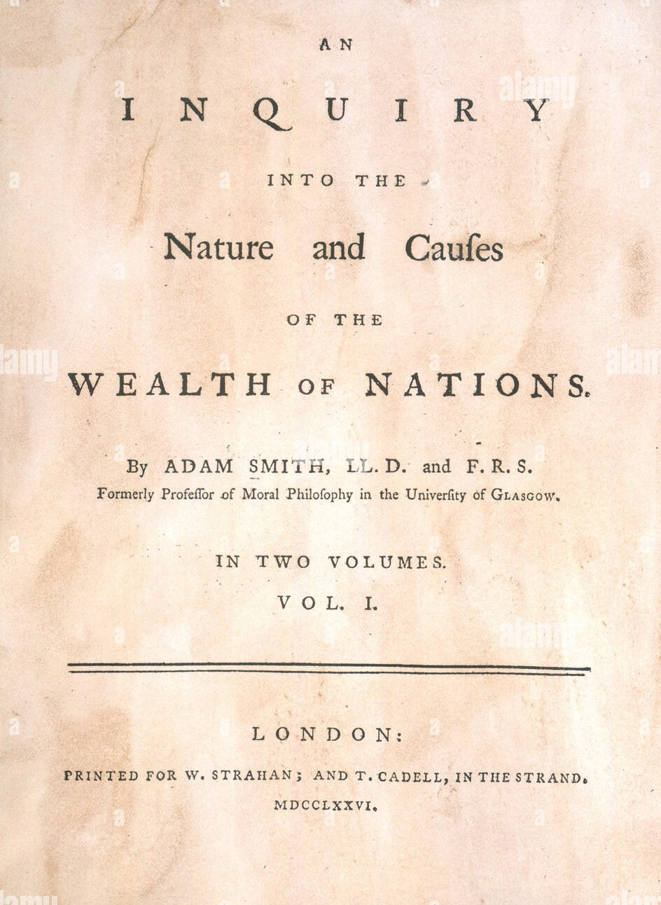

## The Wealth of Nations

- Not about gold or silver
  - Critique of **mercantilism** (wealth ≠ bullion)
  - Real wealth = **goods and services** people can consume
  - Money is a tool, not wealth itself

- Central claim:
  - Wealth comes from **production and exchange**
  - Markets use prices and incentives to coordinate self-interest
  - Exchange is **not zero-sum** → the pie can grow
   
## Recent Evidence on Positive Sum Redistribution

- **Zero-sum thinking** assumes one person’s gain requires another’s loss  
  - Common in debates on immigration and social insurance  
  - Contradicted by evidence showing many policies are **positive-sum**

- **Unemployment insurance (UI) is often framed as zero-sum**
  - “Paying people not to work” 

- **Evidence shows UI is positive-sum** @moore2025benefits
  - UI enables better job matching and higher future earnings  
  - Recipients generate more income than the cost of benefits  
  - Society gains: higher output, stability, and returns per dollar spent

## Specialization (Division of Labor)

- Sources of wealth:
  - **Specialization** (division of labor)
  - **Freedom to exchange**

- Specialization → higher productivity because:
  - People and places differ (**comparative advantage**)
  - Repetition improves speed and quality (**learning by doing**)
  - Focus enables innovation

## Specialization Example

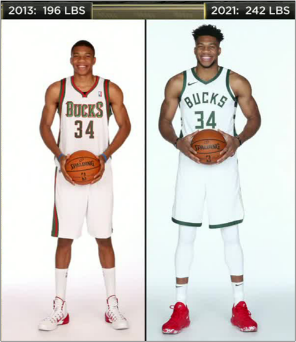

## Economies of Scale

- Production often requires **fixed costs**
  - Fixed vs. variable costs

- Higher output spreads fixed costs
  - → lower average cost

- **Economies of scale**:
  - Average cost falls as output rises  
- **Diseconomies of scale**:
  - Average cost rises as output rises

## Economies of Scale

| Q | FC  | VC | TC | AC |
|---|-----|----|----|----|
| 0 | 100 | 0  |    |    |
| 1 |     | 5  |    |    |
| 2 |     | 10 |    |    |
| 3 |     | 15 |    |    |
| 4 |     | 20 |    |    |
| 5 |     | 25 |    |    |

## Economies of Scale

| Q | FC  | VC | TC  | AC  |
|---|-----|----|-----|-----|
| 0 | 100 | 0  | 100 | Inf |
| 1 | 100 | 5  | 105 | 105 |
| 2 | 100 | 10 | 110 | 55  |
| 3 | 100 | 15 | 115 | 33  |
| 4 | 100 | 20 | 120 | 30  |
| 5 | 100 | 25 | 125 | 25  |

## Economies of Scale

```{r}

n <- 5
x <- data.frame(
  q = 0:n,
  fc = rep(100, n+1),
  vc = 0:n*5
)
x$tc <- x$fc + x$vc
x$ac <- x$tc / x$q
x$ac[1] <- NA

par(mar = c(4.5, 4.5, 1, 1))
plot(x$q, x$ac, 
     xlab = "Quantity of Production", 
     ylab = "Average Cost of Prod.", 
     cex.axis = 1.25, cex.lab = 1.5, 
     type = "l", lwd = 4,
     ylim = c(0, max(x$ac[!is.na(x$ac)])))
points(x$q, x$ac, pch = 19, cex = 2)
segments(-1, x$ac, x$q, x$ac,
         lty = 2, lwd = 2)
segments(x$q, -1, x$q, x$ac,
         lty = 2, lwd = 2)

```

## Gains from Trade Model

- Classic model showing **positive-sum exchange**
  - PPF
  - Specialization & exchange
  - Gains from trade

- Simple 2×2 setup:
  - 2 people, 2 goods
  - Shows comparative advantage, specialization, and higher consumption
  - **Dynamic** = gains unfold over time

## Production Possibilities Frontier

- Shows the **maximum** output combinations
  - Given full use of: land, labor, capital, entrepreneurship

- **Productive efficiency**:
  - More of one good requires less of another

## Production Possibilities Frontier

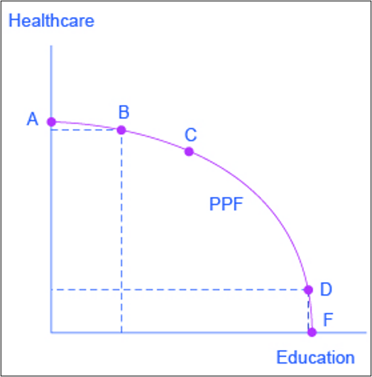

## Production Possibilities Frontier

```{=html}
<div style="display:grid; grid-template-columns: 1.1fr 0.9fr; gap: 2rem; align-items:center;">
  <div>
    <ul>
      <li class="fragment">
        A society could choose to produce any combination of healthcare and education on the production possibilities frontier
      <li class="fragment">
        It does not have enough resources to produce outside the PPF
      <li class="fragment">
        The downward slope highlights a <strong>tradeoff</strong> -- that the only way society can obtain more education is by giving up some healthcare (and vice versa)
          </li>
        </ul>
      </li>
    </ul>
  </div>

  <div style="text-align:center;">
    
  </div>
</div>
```

## Production Possibilities Frontier

```{=html}
<div style="display:grid; grid-template-columns: 1.1fr 0.9fr; gap: 2rem; align-items:center;">
  <div>
    <ul>
      <li class="fragment">
        The <strong>slope</strong> of the PPF represents the opportunity cost of the good on the y-axis
      <li class="fragment">
        A “bowed-out” (linear) PPF represents that opportunity costs are increasing (constant)
          </li>
        </ul>
      </li>
    </ul>
  </div>

  <div style="text-align:center;">
    
  </div>
</div>
```

## Production Possibilities Frontier

```{=html}
<div style="position:relative;padding-top:75%;height:0;">
  <iframe
    src="https://www.desmos.com/calculator/fqxsraw3gc"
    data-external="1"
    style="position:absolute;top:0;left:0;width:85%;height:65%;border:1px solid #ccc;"
    allowfullscreen>
  </iframe>
</div>
```

## Comparative Advantage

- People and countries face different **opportunity costs**
  - Due to climate, geography, technology, or skills

- **Comparative advantage**:
  - Ability to produce a good at **lower opportunity cost**
  - Someone *always* has a comparative advantage

- **Key insight**:
  - Trade depends on comparative, not absolute, advantage

## Comparative Advantage Example 1

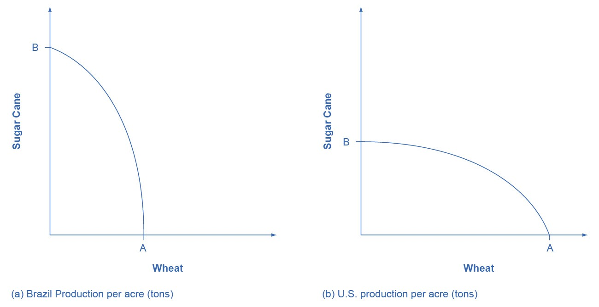

- Brazil has a steeper PPF → forgo more sugar per ton of wheat produced
  - US (Brazil) should specialize in producing wheat (sugar)

## Comparative Advantage Example 2

- Suppose that James and Keri can each can produce one of two goods: gadgets and widgets
  - Keri: 50 gadgets and 25 widgets
  - James: 30 gadgets and 10 widgets

- Keri has an absolute advantage in production since she can produce more

## Comparative Advantage Example 2

```{=html}
<div style="position:relative;padding-top:75%;height:0;">
  <iframe
    src="https://www.desmos.com/calculator/2330e9aeab"
    data-external="1"
    style="position:absolute;top:0;left:0;width:85%;height:65%;border:1px solid #ccc;"
    allowfullscreen>
  </iframe>
</div>
```

## Comparative Advantage Example 2

<style>
/* Make the table fill nicely and draw all borders consistently */
.tg{
  border-collapse: collapse;
  width: 92%;
  margin: 0 auto;                 /* center horizontally */
  border: 2px solid #000;         /* outer border, ensures bottom edge is visible */
  table-layout: fixed;            /* prevents column blow-ups */
}
.tg th, .tg td{
  border: 1.5px solid #000 !important;   /* override revealjs dotted borders */
  padding: 8px 10px;
  word-break: normal;
  text-align: center;
  vertical-align: middle;
  font-family: Arial, sans-serif;
  font-size: clamp(18px, 2.4vw, 32px);   /* scale to slide size */
}
/* Ensure the final row has a visible bottom line even with collapse */
.tg tbody tr:last-child td, .tg tbody tr:last-child th{
  border-bottom: 2px solid #000 !important;
}
</style>

<table class="tg">
  <thead>
    <tr>
      <th></th>
      <th colspan="2">Keri</th>
      <th colspan="2">James</th>
    </tr>
    <tr>
      <th></th>
      <th>Gadgets</th>
      <th>Widgets</th>
      <th>Gadgets</th>
      <th>Widgets</th>
    </tr>
  </thead>
  <tbody>
    <tr>
      <td>Production</td>
      <td>50</td>
      <td>25</td>
      <td>30</td>
      <td>10</td>
    </tr>
    <tr>
      <td>Opp. Cost</td>
      <td></td><td></td><td></td><td></td>
    </tr>
  </tbody>
</table>

## Comparative Advantage Example 2

<table class="tg">
  <thead>
    <tr>
      <th></th>
      <th colspan="2">Keri</th>
      <th colspan="2">James</th>
    </tr>
    <tr>
      <th></th>
      <th>Gadgets</th>
      <th>Widgets</th>
      <th>Gadgets</th>
      <th>Widgets</th>
    </tr>
  </thead>
  <tbody>
    <tr>
      <td>Production</td>
      <td>50</td>
      <td>25</td>
      <td>30</td>
      <td>10</td>
    </tr>
    <tr>
      <td>Opp. Cost</td>
      <td>$\dfrac{-25 W}{+ 50 G}$</td>
      <td>$\dfrac{-50 G}{+25 W}$</td>
      <td>$\dfrac{-10 W}{+ 30 G}$</td>
      <td>$\dfrac{-30 G}{+ 10 W}$</td>
    </tr>
  </tbody>
</table>

## Comparative Advantage Example 2

<table class="tg">
  <thead>
    <tr>
      <th></th>
      <th colspan="2">Keri</th>
      <th colspan="2">James</th>
    </tr>
    <tr>
      <th></th>
      <th>Gadgets</th>
      <th>Widgets</th>
      <th>Gadgets</th>
      <th>Widgets</th>
    </tr>
  </thead>
  <tbody>
    <tr>
      <td>Production</td>
      <td>50</td>
      <td>25</td>
      <td>30</td>
      <td>10</td>
    </tr>
    <tr>
      <td>Opp. Cost</td>
      <td>$\dfrac{-25 W}{+ 50 G}$</td>
      <td>$\dfrac{-50 G}{+25 W}$</td>
      <td>$\dfrac{-10 W}{+ 30 G}$</td>
      <td>$\dfrac{-30 G}{+ 10 W}$</td>
    </tr>
    <tr>
      <td>Opp. Cost</td>
      <td>$\dfrac{-0.5 W}{+1 G}$</td>
      <td>$\dfrac{-2 G}{+1 W}$</td>
      <td>$\dfrac{-0.\bar{3} W}{+1 G}$</td>
      <td>$\dfrac{-3 G}{+1 W}$</td>
    </tr>
  </tbody>
</table>

## Comparative Advantage Example 2

<table class="tg">
  <thead>
    <tr>
      <th></th>
      <th colspan="2">Keri</th>
      <th colspan="2">James</th>
    </tr>
    <tr>
      <th></th>
      <th>Gadgets</th>
      <th>Widgets</th>
      <th>Gadgets</th>
      <th>Widgets</th>
    </tr>
  </thead>
  <tbody>
    <tr>
      <td>Production</td>
      <td>50</td>
      <td>25</td>
      <td>30</td>
      <td>10</td>
    </tr>
    <tr>
      <td>Opp. Cost</td>
      <td>$\dfrac{-25 W}{+ 50 G}$</td>
      <td>$\dfrac{-50 G}{+25 W}$</td>
      <td>$\dfrac{-10 W}{+ 30 G}$</td>
      <td>$\dfrac{-30 G}{+ 10 W}$</td>
    </tr>
    <tr>
      <td>Opp. Cost</td>
      <td>$\dfrac{-0.5 W}{+1 G}$</td>
      <td>$\dfrac{-2 G}{+1 W}$</td>
      <td>$\dfrac{-0.\bar{3} W}{+1 G}$</td>
      <td>$\dfrac{-3 G}{+1 W}$</td>
    </tr>
    <tr>
      <td>Opp. Cost</td>
      <td>$\dfrac{-0.5 W}{+1 G}$</td>
      <td>$\dfrac{-2 G}{+1 W}$</td>
      <td>$\dfrac{-0.\bar{3} W}{+1 G}$</td>
      <td>$\dfrac{-3 G}{+1 W}$</td>
    </tr>
  </tbody>
</table>

## Comparative Advantage Example 2

<table class="tg">
  <thead>
    <tr>
      <th></th>
      <th colspan="2">Keri</th>
      <th colspan="2">James</th>
    </tr>
    <tr>
      <th></th>
      <th>Gadgets</th>
      <th>Widgets</th>
      <th>Gadgets</th>
      <th>Widgets</th>
    </tr>
  </thead>
  <tbody>
    <tr>
      <td>Production</td>
      <td>50</td>
      <td>25</td>
      <td>30</td>
      <td>10</td>
    </tr>
    <tr>
      <td>Opp. Cost</td>
      <td>$\dfrac{-25 W}{+ 50 G}$</td>
      <td>$\dfrac{-50 G}{+25 W}$</td>
      <td>$\dfrac{-10 W}{+ 30 G}$</td>
      <td>$\dfrac{-30 G}{+ 10 W}$</td>
    </tr>
    <tr>
      <td>Opp. Cost</td>
      <td>$\dfrac{-0.5 W}{+1 G}$</td>
      <td>$\dfrac{-2 G}{+1 W}$</td>
      <td>$\dfrac{-0.\bar{3} W}{+1 G}$</td>
      <td>$\dfrac{-3 G}{+1 W}$</td>
    </tr>
    <tr>
      <td>Opp. Cost</td>
      <td>$\dfrac{-0.5 W}{+1 G}$</td>
      <td>$\dfrac{-2 G}{+1 W}$</td>
      <td>$\dfrac{-0.\bar{3} W}{+1 G}$</td>
      <td>$\dfrac{-3 G}{+1 W}$</td>
    </tr>
    <tr>
      <td>Opp. Cost</td>
      <td>$0.5 W$</td>
      <td>$2 G$</td>
      <td>$0.\bar{3} W$</td>
      <td>$3 G$</td>
    </tr>
  </tbody>
</table>

## Comparative Advantage Example 2

```{=html}
<div style="position:relative;padding-top:75%;height:0;">
  <iframe
    src="https://www.desmos.com/calculator/2330e9aeab"
    data-external="1"
    style="position:absolute;top:0;left:0;width:85%;height:65%;border:1px solid #ccc;"
    allowfullscreen>
  </iframe>
</div>
```

## Specialization and Trade

- James would never trade more than 3 gadgets for 1 widget

- Keri would never accept fewer than 2 gadgets for 1 widget

- Mutually beneficial exchange: 2.5 gadgets for 1 widget
  - Example: 25G for 10 W

## Specialization and Trade

```{=html}
<div style="position:relative;padding-top:75%;height:0;">
  <iframe
    src="https://www.desmos.com/calculator/2330e9aeab"
    data-external="1"
    style="position:absolute;top:0;left:0;width:85%;height:65%;border:1px solid #ccc;"
    allowfullscreen>
  </iframe>
</div>
```

## Comparative Advantage Example 3

<table class="tg">
  <thead>
    <tr>
      <th></th>
      <th colspan="2">Sean</th>
      <th colspan="2">Bryan</th>
    </tr>
    <tr>
      <th></th>
      <th>Cooking</th>
      <th>Cleaning</th>
      <th>Cooking</th>
      <th>Cleaning</th>
    </tr>
  </thead>
  <tbody>
    <tr>
      <td>Time to completion (min)</td>
      <td>60</td>
      <td>30</td>
      <td>40</td>
      <td>40</td>
    </tr>
    <tr>
  <td>Units produced in 2 hours</td>
    <td></td>
    <td></td>
    <td></td>
    <td></td>
  </tr>
  <td>Opportunity Cost</td>
    <td></td>
    <td></td>
    <td></td>
    <td></td>
  </tr>
  </tbody>
</table>

## Comparative Advantage Example 3: PPF

<table class="tg">
  <thead>
    <tr>
      <th></th>
      <th colspan="2">Sean</th>
      <th colspan="2">Bryan</th>
    </tr>
    <tr>
      <th></th>
      <th>Cooking</th>
      <th>Cleaning</th>
      <th>Cooking</th>
      <th>Cleaning</th>
    </tr>
  </thead>
  <tbody>
    <tr>
      <td>Time to completion (min)</td>
      <td>60</td>
      <td>30</td>
      <td>40</td>
      <td>40</td>
    </tr>
    <tr>
  <td>Units produced in 2 hours</td>
    <td>2 meals</td>
    <td>4 rooms</td>
    <td>3 meals</td>
    <td>3 rooms</td>
  </tr>
  <td>Opportunity Cost</td>
    <td></td>
    <td></td>
    <td></td>
    <td></td>
  </tr>
  </tbody>
</table>

## Comparative Advantage Example 3: PPF

```{=html}
<div style="position:relative;padding-top:75%;height:0;">
  <iframe
    src="https://www.desmos.com/calculator/3fd2057cf7"
    data-external="1"
    style="position:absolute;top:0;left:0;width:85%;height:65%;border:1px solid #ccc;"
    allowfullscreen>
  </iframe>
</div>
```

## Comparative Advantage Example 3: Opportunity Cost

<table class="tg">
  <thead>
    <tr>
      <th></th>
      <th colspan="2">Sean</th>
      <th colspan="2">Bryan</th>
    </tr>
    <tr>
      <th></th>
      <th>Cooking</th>
      <th>Cleaning</th>
      <th>Cooking</th>
      <th>Cleaning</th>
    </tr>
  </thead>
  <tbody>
    <tr>
      <td>Time to completion (min)</td>
      <td>60</td>
      <td>30</td>
      <td>40</td>
      <td>40</td>
    </tr>
    <tr>
  <td>Units produced in 2 hours</td>
    <td>2 meals</td>
    <td>4 rooms</td>
    <td>3 meals</td>
    <td>3 rooms</td>
  </tr>
  <td>Opportunity Cost</td>
    <td>$\frac{-4r}{+2m}$</td>
    <td>$\frac{-2m}{+4r}$</td>
    <td>$\frac{-3r}{+3m}$</td>
    <td>$\frac{-3m}{+3r}$</td>
  </tr>
  </tbody>
</table>

## Comparative Advantage Example 3: Opportunity Cost

<table class="tg">
  <thead>
    <tr>
      <th></th>
      <th colspan="2">Sean</th>
      <th colspan="2">Bryan</th>
    </tr>
    <tr>
      <th></th>
      <th>Cooking</th>
      <th>Cleaning</th>
      <th>Cooking</th>
      <th>Cleaning</th>
    </tr>
  </thead>
  <tbody>
    <tr>
      <td>Time to completion (min)</td>
      <td>60</td>
      <td>30</td>
      <td>40</td>
      <td>40</td>
    </tr>
    <tr>
  <td>Units produced in 2 hours</td>
    <td>2 meals</td>
    <td>4 rooms</td>
    <td>3 meals</td>
    <td>3 rooms</td>
  </tr>
  <td>Opportunity Cost</td>
    <td>$\frac{-2r}{+1m}$</td>
    <td>$\frac{-0.5m}{+1r}$</td>
    <td>$\frac{-1r}{+1m}$</td>
    <td>$\frac{-1m}{+1r}$</td>
  </tr>
  </tbody>
</table>

## Comparative Advantage Example 3: Opportunity Cost

<table class="tg">
  <thead>
    <tr>
      <th></th>
      <th colspan="2">Sean</th>
      <th colspan="2">Bryan</th>
    </tr>
    <tr>
      <th></th>
      <th>Cooking</th>
      <th>Cleaning</th>
      <th>Cooking</th>
      <th>Cleaning</th>
    </tr>
  </thead>
  <tbody>
    <tr>
      <td>Time to completion (min)</td>
      <td>60</td>
      <td>30</td>
      <td>40</td>
      <td>40</td>
    </tr>
    <tr>
  <td>Units produced in 2 hours</td>
    <td>2 meals</td>
    <td>4 rooms</td>
    <td>3 meals</td>
    <td>3 rooms</td>
  </tr>
  <td>Opportunity Cost</td>
    <td>$2r$</td>
    <td>$0.5m$</td>
    <td>$1r$</td>
    <td>$1m$</td>
  </tr>
  </tbody>
</table>

## Comparative Advantage Example 3: Specialization

```{=html}
<div style="position:relative;padding-top:75%;height:0;">
  <iframe
    src="https://www.desmos.com/calculator/3fd2057cf7"
    data-external="1"
    style="position:absolute;top:0;left:0;width:85%;height:65%;border:1px solid #ccc;"
    allowfullscreen>
  </iframe>
</div>
```

## Comparative Advantage Example 3: Terms of Trade

<table class="tg">
  <thead>
    <tr>
      <th></th>
      <th colspan="2">Sean</th>
      <th colspan="2">Bryan</th>
    </tr>
    <tr>
      <th></th>
      <th>Cooking</th>
      <th>$Cleaning$</th>
      <th>$Cooking$</th>
      <th>Cleaning</th>
    </tr>
  </thead>
  <tbody>
  <td>Opportunity Cost</td>
    <td>$2r$</td>
    <td>$0.5m$</td>
    <td>$1r$</td>
    <td>$1m$</td>
  </tr>
  </tbody>
</table>

- Sean would never give up more than ___ cleaned rooms for 1 meal

- Bryan would never accept fewer than ___ cleaned room for 1 meal

- terms of exchange: ___ rooms for each meal

## Comparative Advantage Example 3: Terms of Trade

<table class="tg">
  <thead>
    <tr>
      <th></th>
      <th colspan="2">Sean</th>
      <th colspan="2">Bryan</th>
    </tr>
    <tr>
      <th></th>
      <th>Cooking</th>
      <th>$Cleaning$</th>
      <th>$Cooking$</th>
      <th>Cleaning</th>
    </tr>
  </thead>
  <tbody>
  <td>Opportunity Cost</td>
    <td>$2r$</td>
    <td>$0.5m$</td>
    <td>$1r$</td>
    <td>$1m$</td>
  </tr>
  </tbody>
</table>

- Sean would never give up more than [_2_]{.underline} cleaned rooms for 1 meal

- Bryan would never accept fewer than [_1_]{.underline} cleaned room for 1 meal

- terms of exchange: [_1.5_]{.underline} rooms for each meal

## Comparative Advantage Example 3: Terms of Trade

<table class="tg">
  <thead>
    <tr>
      <th></th>
      <th colspan="2">Sean</th>
      <th colspan="2">Bryan</th>
    </tr>
    <tr>
      <th></th>
      <th>Cooking</th>
      <th>$Cleaning$</th>
      <th>$Cooking$</th>
      <th>Cleaning</th>
    </tr>
  </thead>
  <tbody>
  <td>Opportunity Cost</td>
    <td>$2r$</td>
    <td>$0.5m$</td>
    <td>$1r$</td>
    <td>$1m$</td>
  </tr>
  </tbody>
</table>

- Bryan would never give up more than ___ meals for every 1 cleaned room

- Sean would never accept fewer than ___ meals for every 1 cleaned room

- terms of exchange: ___ meals for each room

## Comparative Advantage Example 3: Terms of Trade

<table class="tg">
  <thead>
    <tr>
      <th></th>
      <th colspan="2">Sean</th>
      <th colspan="2">Bryan</th>
    </tr>
    <tr>
      <th></th>
      <th>Cooking</th>
      <th>$Cleaning$</th>
      <th>$Cooking$</th>
      <th>Cleaning</th>
    </tr>
  </thead>
  <tbody>
  <td>Opportunity Cost</td>
    <td>$2r$</td>
    <td>$0.5m$</td>
    <td>$1r$</td>
    <td>$1m$</td>
  </tr>
  </tbody>
</table>

- Bryan would never give up more than [_1_]{.underline} meals for every 1 cleaned room

- Sean would never accept fewer than [_0.5_]{.underline} meals for every 1 cleaned room

- terms of exchange: [_0.75_]{.underline} meals for each room

## Comparative Advantage Example 4: Specialization Dynamics

<table class="tg">
  <thead>
    <tr>
      <th></th>
      <th colspan="2">Keri</th>
      <th colspan="2">James</th>
    </tr>
    <tr>
      <th></th>
      <th>Gadgets</th>
      <th>Widgets</th>
      <th>Gadgets</th>
      <th>Widgets</th>
    </tr>
  </thead>
  <tbody>
    <tr>
      <td>Production</td>
      <td>50</td>
      <td>25</td>
      <td>30</td>
      <td>10</td>
    </tr>
    <tr>
  <td>Opp. Cost</td>
    <td>$0.5\,W$</td>
    <td>$\boldsymbol{2G}$</td>
    <td>$\boldsymbol{0.\overline{3}\,W}$</td>
    <td>$3\,G$</td>
  </tr>
  <tr>
  <td>Specialized Production</td>
    <td>50</td>
    <td>25+10</td>
    <td>30+10</td>
    <td>10</td>
  </tr>
  <tr>
  <td>Opp. Cost</td>
    <td></td>
    <td></td>
    <td></td>
    <td></td>
  </tr>
  </tbody>
</table>

## Comparative Advantage Example 4: Specialization Dynamics

```{=html}
<div style="position:relative;padding-top:75%;height:0;">
  <iframe
    src="https://www.desmos.com/calculator/2330e9aeab"
    data-external="1"
    style="position:absolute;top:0;left:0;width:85%;height:65%;border:1px solid #ccc;"
    allowfullscreen>
  </iframe>
</div>
```

## Comparative Advantage Example 4: Specialization Dynamics

<table class="tg">
  <thead>
    <tr>
      <th></th>
      <th colspan="2">Keri</th>
      <th colspan="2">James</th>
    </tr>
    <tr>
      <th></th>
      <th>Gadgets</th>
      <th>Widgets</th>
      <th>Gadgets</th>
      <th>Widgets</th>
    </tr>
  </thead>
  <tbody>
    <tr>
      <td>Production</td>
      <td>50</td>
      <td>25</td>
      <td>30</td>
      <td>10</td>
    </tr>
    <tr>
  <td>Opp. Cost</td>
    <td>$0.5\,W$</td>
    <td>$\boldsymbol{2G}$</td>
    <td>$\boldsymbol{0.\overline{3}\,W}$</td>
    <td>$3\,G$</td>
  </tr>
  <tr>
  <td>Specialized Production</td>
    <td>50</td>
    <td>25+10</td>
    <td>30+10</td>
    <td>10</td>
  </tr>
  <tr>
  <td>Opp. Cost</td>
    <td>$\frac{-35 W}{+ 50 G}$</td>
    <td>$\frac{-50 G}{+ 35 W}$</td>
    <td>$\frac{-10 W}{+ 40 G}$</td>
    <td>$\frac{-40 G}{+ 10 W}$</td>
  </tr>
  </tbody>
</table>

## Comparative Advantage Example 4: Specialization Dynamics

<table class="tg">
  <thead>
    <tr>
      <th></th>
      <th colspan="2">Keri</th>
      <th colspan="2">James</th>
    </tr>
    <tr>
      <th></th>
      <th>Gadgets</th>
      <th>Widgets</th>
      <th>Gadgets</th>
      <th>Widgets</th>
    </tr>
  </thead>
  <tbody>
    <tr>
      <td>Production</td>
      <td>50</td>
      <td>25</td>
      <td>30</td>
      <td>10</td>
    </tr>
    <tr>
  <td>Opp. Cost</td>
    <td>$0.5\,W$</td>
    <td>$\boldsymbol{2G}$</td>
    <td>$\boldsymbol{0.\overline{3}\,W}$</td>
    <td>$3\,G$</td>
  </tr>
  <tr>
  <td>Specialized Production</td>
    <td>50</td>
    <td>25+10</td>
    <td>30+10</td>
    <td>10</td>
  </tr>
  <tr>
  <td>Opp. Cost</td>
    <td>$0.7 W$</td>
    <td>$1.43 G$</td>
    <td>$0.25 W$</td>
    <td>$4 G$</td>
  </tr>
  </tbody>
</table>

## Economic Systems

- **Scarcity requires rationing**
  - Some rule must decide who gets the good

- Allocation rules don’t eliminate competition
  - They change *how* people compete

- Common rationing methods:
  - **Government** → political influence
  - **First-come, first-served** → time & waiting
  - **Markets** → willingness to pay

## Economic systems

```{=html}
<div style="display:flex; gap:2rem; align-items:flex-start;">
  <div style="flex:1; min-width:260px;">
    <h3 style="margin:0 0 .25rem 0;">Command Economies</h3>
    <ul style="margin-top:.25rem;">
      <li>Centralized decision making</li>
      <li>Allocation by politicians</li>
      <li>Public ownership of factors</li>
      <li>&ne; "communist"</li>
    </ul>
  </div>

  <div style="flex:1; min-width:260px;">
    <h3 style="margin:0 0 .25rem 0;">Market Economies</h3>
    <ul style="margin-top:.25rem;">
      <li>Decentralized decision making</li>
      <li>Allocation by individuals</li>
      <li>Private ownership</li>
      <li>&ne; "capitalist"</li>
    </ul>
  </div>
</div>
```

## Allocative Efficiency

- **Allocative efficiency**: Goods and services reflect what people value most

- In decentralized markets:
  - Individuals act in **self-interest**
  - Exchange occurs only if both sides benefit

- Result:
  - Private choices promote social welfare
  - As described by Smith's *“invisible hand”*

## Smith on self-interest

"*It is not from the benevolence of the butcher, the brewer, or the baker that we expect our dinner, but from their regard to their own self-interest. We address ourselves not to their humanity but to their self-love, and never talk to them of our own necessities, but of their advantages.*"

## Smith on self-interest and allocative efficiency

"*Every individual... neither intends to promote the public interest, nor knows how much he is promoting it... he intends only his own security; and by directing that industry in such a manner as its produce may be of the greatest value, he intends only his own gain, and he is in this, as in many other cases, led by an invisible hand to promote an end which was no part of his intention.*"

## Smith on self-interest and allocative efficiency

"*[Without trade restrictions] the obvious and simple system of natural liberty establishes itself of its own accord. Every man...is left perfectly free to pursue his own interest in his own way.... The sovereign is completely discharged from a duty [for which] no human wisdom or knowledge could ever be sufficient; the duty of superintending the industry of private people, and of directing it towards the employments most suitable to the interest of the society.*"

## Smith on the folly of centralized planning

"*The man of system…is apt to be very wise in his own conceit; and is often so enamoured with the supposed beauty of his own ideal plan of government, that he cannot suffer the smallest deviation from any part of it… He seems to imagine that he can arrange the different members of a great society with as much ease as the hand arranges the different pieces upon a chess-board. He does not consider that in the great chess-board of human society, every single piece has a principle of motion of its own, altogether different from that which the legislature might choose to impress upon it.*"

"*The curious task of economics is to demonstrate to men how little they really know about what they imagine they can design.*" - FA Hayek (1988)

## Smith on personal freedoms

“*The property which every man has in his own labour ... is the most sacred and inviolable. The patrimony of a poor man lies in the strength and dexterity of his hands; and to hinder him from employing this strength and dexterity in what manner he thinks proper without injury to his neighbour, is a plain violation of this most sacred property. It is a manifest encroachment upon the just liberty both of the workman, and of those who might be disposed to employ him. As it hinders the one from working at what he thinks proper, so it hinders the others from employing whom they think proper. To judge whether he is fit to be employed, may surely be trusted to the discretion of the employers whose interest it so much concerns. The affected anxiety of the law-giver lest they should employ an improper person, is evidently as impertinent as it is oppressive.*”

## Smith on jusice and inequality

"*Little else is requisite to carry a state to the highest degree of opulence from the lowest barbarism, but peace, easy taxes, and a tolerable administration of justice: all the rest being brought about by the natural course of things.*"

“Laissez-faire”: An economic doctrine that opposes governmental regulation of or interference in commerce beyond the minimum necessary for a free-enterprise system to operate according to its own economic laws.

"*What improves the circumstances of the greater part can never be regarded as an inconveniency to the whole. No society can surely be flourishing and happy, of which the far greater part of the members are poor and miserable.*"

## Economic Freedom

- **Economic Freedom of the World**
  - Annual index measuring how freely people can create and exchange
  - @hall2014economic

- Core principles:
  - Personal choice over collective choice
  - Voluntary exchange via markets
  - Open entry and competition
  - Secure property rights

## Economic Freedom

- What the index measures:
  - Size of government (taxes, spending, state enterprises)
  - Property rights & sound money
  - Trade openness
  - Regulation of credit, labor, and business

- Built from **50+ indicators**
  - Taxes, inflation, judicial independence, trade costs, etc.

## Economic Freedom

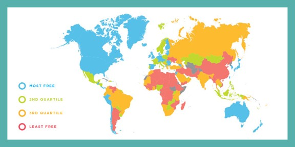

## Economic Freedom and Income / Investment

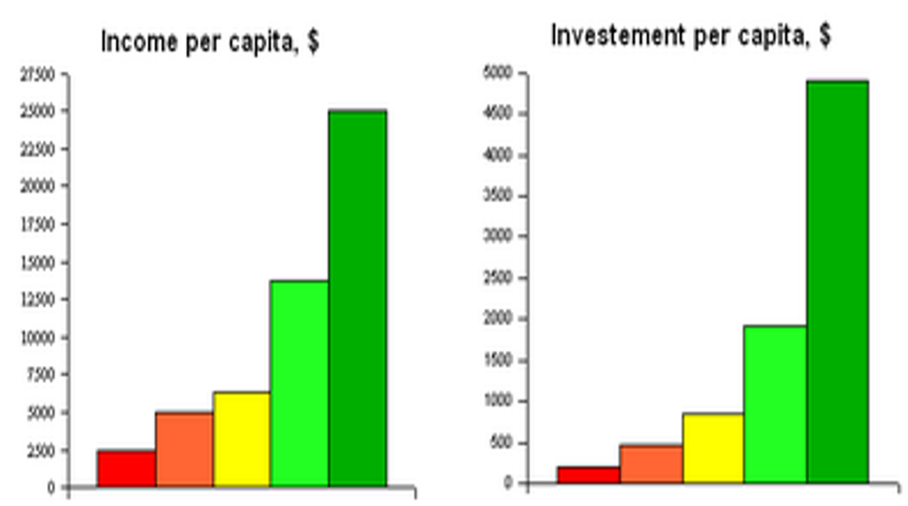

## Economic Freedom and Poverty

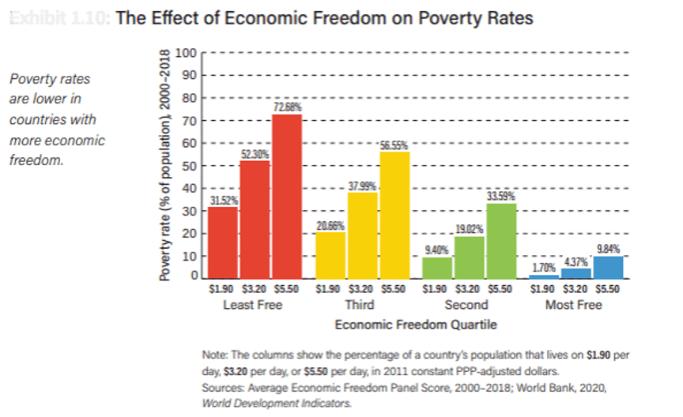

## Economic Freedom and Income of the Poor

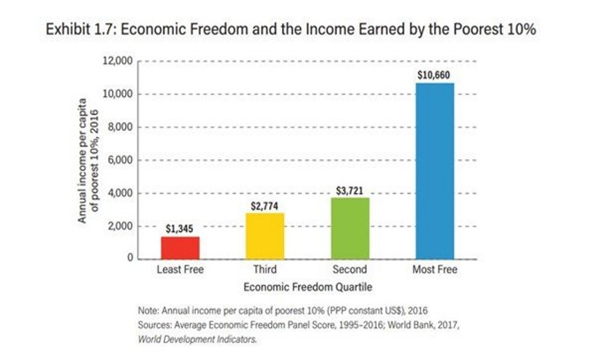

## Economic Freedom and Life Outcomes

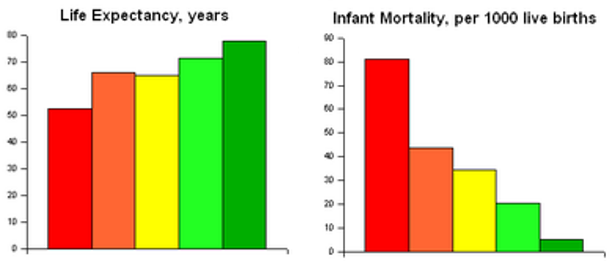

## Economic Freedom and Life Outcomes

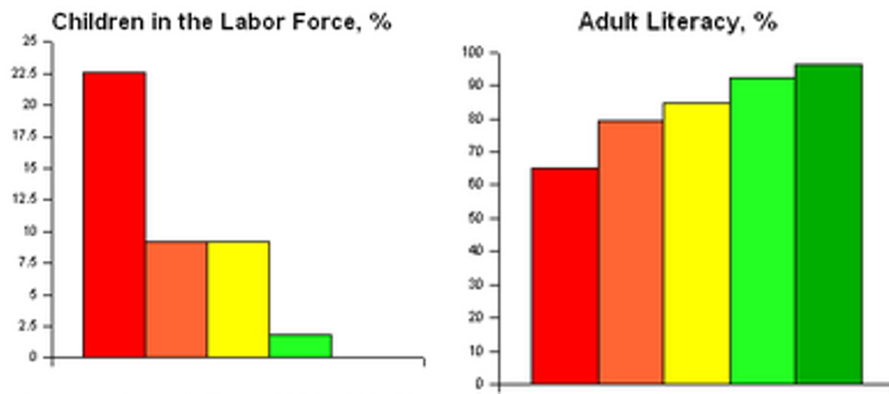

## The Correlational Impact of Economic Freedom

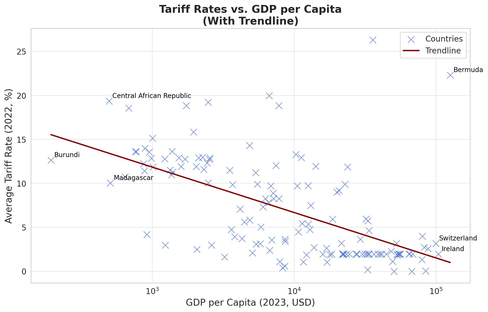

## The Causal Impact of Economic Freedom

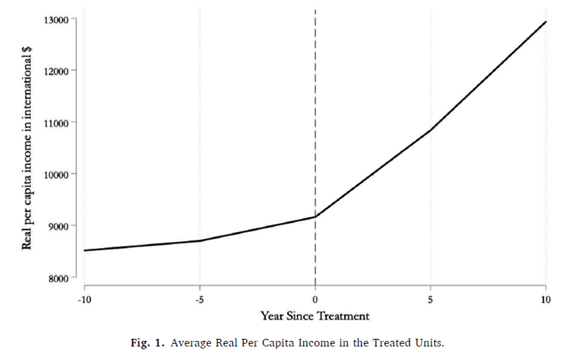

@GrierGrier2021WashingtonConsensus

## References
