## The Paradox of Value

- Which is more valuable: **diamonds** or **water**?
  - Diamonds have greater **exchange value**
  - Water has greater **use value**

- Why does something essential (water) cost so little, while something non-essential (diamonds) costs so much?

## Utility

- **Utility**: the satisfaction or benefit a person receives from consumption

- Utility is:
  - **Subjective**
  - **Context-dependent**
  - **Not directly observable**

- Economists do not measure utility directly; we *infer* it from choices

## Revealed Preferences

- **Revealed preferences**: choices reveal the ordering of preferences
  - If $A \succ B$ and $B \succ C$, then $A \succ C$

- **Willingness to pay** provides a practical way to approximate utility

## Marginal Utility

- **Marginal utility**: the additional satisfaction from one more unit of a good
  - **Law of diminishing marginal utility**: Utility increases with consumption, but at a **decreasing rate**

- Because water is abundant, its **marginal utility** is low

- Because diamonds are scarce, their **marginal utility** is high

## Demand

- If:
  - Utility $\approx$ willingness to pay, and
  - Marginal utility falls with each additional unit consumed,

- Then:
  - **Price and quantity demanded are negatively related**
  - This is the **Law of Demand**

## Why Does the Law of Demand Hold?

Three reinforcing forces:

- **1. Diminishing Marginal Utility**
  - Each additional unit provides less additional satisfaction

- **2. Income Effect**
  - When price rises, purchasing power falls
  - Like a pay cut: you can afford less overall

- **3. Substitution Effect**
  - When a good becomes relatively more expensive, people shift toward alternatives
  - Example: if the price of coffee rises, some consumers switch to tea

## Demand

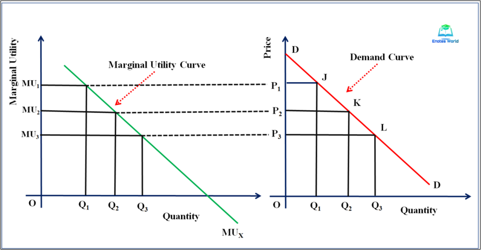

## Demand

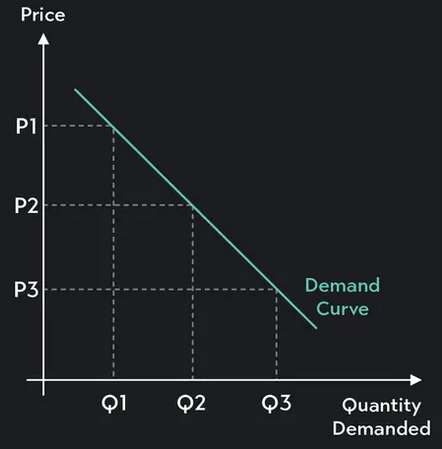

## Determinants of Demand

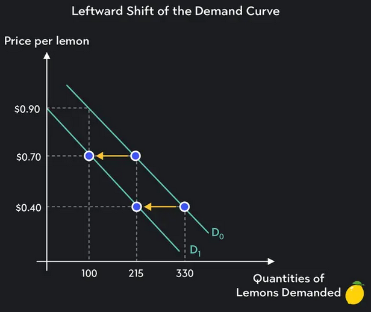

## Determinants of Demand

A change in any of the following shifts the **entire demand curve**:

- **Tastes and Preferences**
  - If Crocs become more popular → demand increases
  - If they fall out of fashion → demand decreases

- **Number of Buyers**
  - Larger population → greater demand
  - Increase in the legal drinking age → fewer buyers → lower demand for alcohol

## Determinants of Demand

A change in any of the following shifts the **entire demand curve**:

- **Income**
  - **Normal goods**: demand rises as income rises
  - **Inferior goods**: demand falls as income rises

- **Prices of Related Goods**
  - **Complements**: price of $Y$ ↑ → demand for $X$ ↓  
  - **Substitutes**: price of $Y$ ↑ → demand for $X$ ↑

## Determinants of Demand: Research Example

- **Prohibition and Percolation: The Roaring Success of Coffee During US Alcohol Prohibition** @bartsch2026prohibition
  - "During US alcohol prohibition, 1920 to 1933, alcohol consumption fell dramatically. Less well known is that coffee consumption surged as a legal alternative. Using import data and a variety of textual data, I examine prohibition's impact on demand for coffee and the supply-side response to the new policy environment.... this study **finds elevated coffee imports** during prohibition and immediately after enactment... The results exemplify the role of legal substitutes to prohibited goods, how policy regimes distort consumption patterns, and how industries respond."
  
## Determinants of Demand

A change in any of the following shifts the **entire demand curve**:

- **Expectations**
  - Expect higher future prices → greater demand today
  - Expect lower future prices → lower demand today

## Determinants of Demand: Research Example

- **Home Price Expectations and Spending: Evidence from a Field Experiment** @chopra2025home
  - "We conduct a field experiment with US households to study how expectations about long-run home price growth shape spending decisions. We exogenously vary survey respondents' expectations by providing different expert forecasts. Homeowners' spending, measured using rich home-scanner data, is inelastic to home price expectations. By contrast, **renters reduce their spending when expecting higher home price growth**. These patterns reflect positive wealth effects for owners from higher future wealth and negative income effects for both groups due to higher future housing costs."

## Demand vs. Quantity Demanded

- **Demand**: the entire relationship between price and quantity

  $$
  Q(P) = a - bP
  $$

- **Quantity demanded**: the specific quantity at a given price

  $$
  Q(P_1) = a - bP_1
  $$

- A **change in price** causes:
  - A movement **along** the demand curve  
  - NOT a shift of the curve

## Demand vs. Quantity demanded

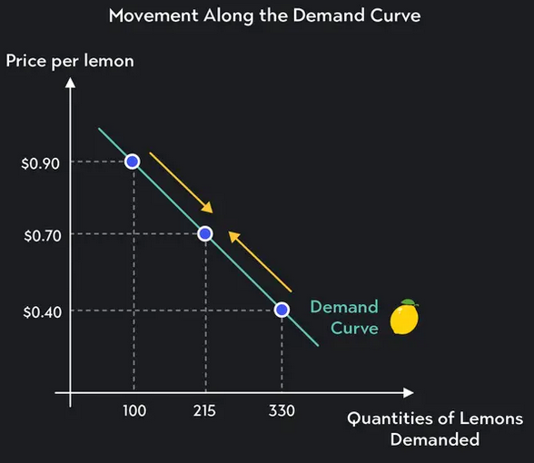

## Demand vs. Quantity demanded

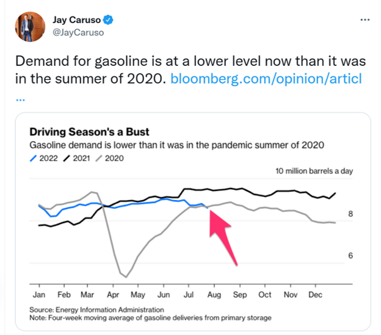

## Elasticity of Demand

- **Price Elasticity of Demand**: measures how responsive quantity demanded is to a change in price

- Visually:
  - **Elastic demand** → relatively flat curve
  - **Inelastic demand** → relatively steep curve

- Interpretation:
  - Elastic: a small change in price → large change in quantity
  - Inelastic: a large change in price → small change in quantity
  
## Elasticity of Demand

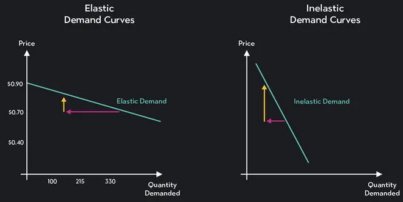

## What Affects Demand Elasticity?

- Elasticity tends to be greater when:
  - There are **close substitutes**
  - Consumers have **weak brand attachment**
  - The good is a **luxury** rather than a necessity
  - Consumers have **more time** to adjust

- Elasticity tends to be smaller when:
  - There are **few substitutes**
  - The good is a **necessity**
  - The good represents a **small share of income**
  

## Elasticity of Demand: Research Example

- **The Impact of Dynamic Prices on Electric Vehicle Public Charging Demand: Evidence from a Nationwide Natural Field Experiment** @bernard2025dynamic
  - "We present results from a large-scale natural field experiment conducted in the United Kingdom, involving approximately 110,000 EV customers and 60% of the country’s public charging infrastructure... Customers were randomly assigned to different price levels, allowing us to estimate the causal effect of price on charging demand and derive elasticities of short-run behavioral responses. **Customers were highly responsive to price**: a 40% reduction in charging costs increased platform-wide charging activity by 117%, while a 15% price cut led to a 30% increase..." 

## Supply

- **Supply** reflects the minimum amount sellers are willing to accept to provide different quantities of a good or service
  - The supply curve represents all quantities sellers are willing to sell at each possible price

- The Law of Supply: There is a **positive relationship** between price and quantity supplied
  - A **change in price** causes a movement along the supply curve
  - A **change in supply** shifts the entire curve
  
## Supply

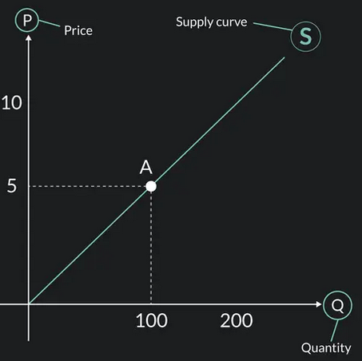

## Why do Supply curves slope upwards?


## Supply vs. Quantity supplied

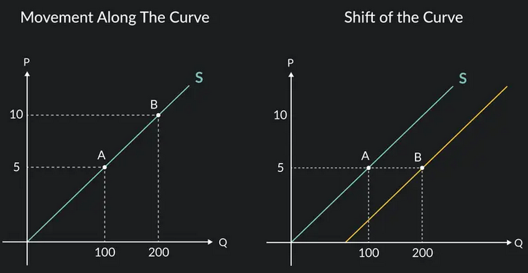

## Determinants of Supply

A change in any of the following shifts the **entire supply curve**:

- **Cost of Inputs**
  - Increase in wages → supply decreases
  - Decrease in raw material costs → supply increases

- **Productivity (Technology)**
  - Improved production technology → supply increases
  - Better worker training → supply increases

## Determinants of Supply

A change in any of the following shifts the **entire supply curve**:

- **Number of Producers**
  - Entry of new firms → supply increases
  - Firms exiting the market → supply decreases

- **Expectations**
  - Expect higher future prices → supply today decreases
  - Expect lower future prices → supply today increases

## Elasticity of Supply

- **Price Elasticity of Supply**: Measures how responsive quantity supplied is to a change in price

- Visually:
  - **Elastic supply** → relatively flat curve
  - **Inelastic supply** → relatively steep curve

- Interpretation:
  - Elastic: a small change in price → large change in quantity supplied
  - Inelastic: a large change in price → small change in quantity supplied
  
## What Affects Supply Elasticity?

The primary determinant is **time**.

- **Short run**:
  - Supply is more inelastic
  - Firms cannot easily adjust capital or capacity
  
- **Long run**:
  - Supply is more elastic
  - Firms can enter, exit, expand, or adopt new technology

- Other factors:
  - Availability of inputs
  - Flexibility of production processes

## Equilibrium

- The Supply & Demand model is a **partial equilibrium (PE)** model

- It focuses on one market at a time
  - Captures the primary effects within that market
  - Does not track all ripple effects across the entire economy

## Equilibrium

- Analogy:
  - Like observing the first wave from a stone thrown into a pond
  - PE models focus on the immediate impact

- A key assumption: **ceteris paribus**
  - "All else equal"
  - We hold other factors constant while analyzing one change

## Market Equilibrium

- The interaction of supply and demand determines market price

- The **equilibrium price** is the price at which:

$$
Q_D = Q_S
$$

- At this price (denoted as $p^*$):
  - Quantity demanded equals quantity supplied
  - There is no pressure for price to change

## Market Equilibrium

It is called "equilibrium" because competitive forces eliminate imbalances

- If price is **too high**: $Q_D < Q_S$  (surplus)
  - Sellers compete for customers
  - Price is pushed **down**
  
- If price is **too low**: $Q_D > Q_S$  (shortage)
  - Buyers compete for goods
  - Price is pushed **up**

## Equilibrium

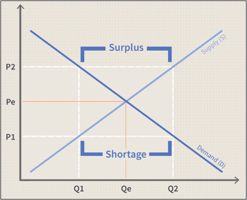

## Demand Increases

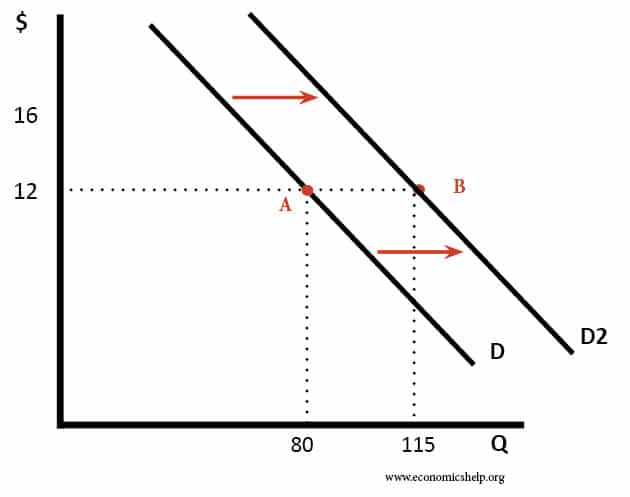

## Demand Increases

- Consider the market for eggs at Easter:
  - $\uparrow D_e$
  - $\uparrow P_e$ and $\uparrow Q_e$

- The higher price serves two key allocation purposes:
  - Encourages consumers to **conserve** (reduce quantity demanded)
  - Encourages producers to **expand output**
    - Prices coordinate behavior without central direction
  
## Demand Decreases

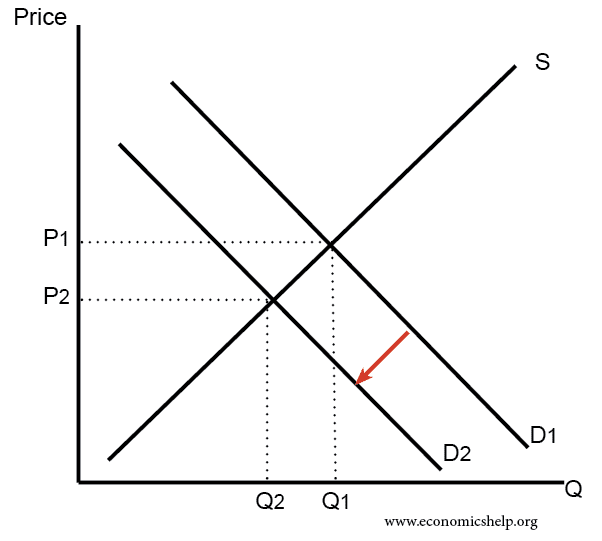

## Demand Decreases

- Consider the market for the Apple Macintosh Portable:
  - $\downarrow D_{pc}$
  - $\downarrow P_{pc}$ and $\downarrow Q_{pc}$

- The lower price serves important allocation purposes:
  - Signals producers that the product is less desired
  - Frees scarce resources (labor, capital, materials) for more valued uses
  
## Creative Destruction & Economic Dynamism

- **Creative destruction** is a process in which new innovations replace and make obsolete older innovations
  - The economy grows not because nothing changes, but because it is constantly reallocating resources to more productive uses

- In a typical year in the U.S.:
  - ~13 million jobs are destroyed  
  - ~16 million jobs are created [@chamberlain2016jobs]

## Creative Destruction & Economic Dynamism

- Modern growth theory was developed by **Philippe Aghion** and **Peter Howitt** (winners of the 2025 Nobel Prize in Economics)
  - "How can an economy grow steadily if millions of jobs are destroyed each year?"

- Because growth is driven by dynamism, not stability.
  - Firms innovate to “escape competition”
  - New entrants replace less productive incumbents
  - Competition creates continuous improvement
  
- Economic growth can appear stable at the macro level  
even though it is turbulent at the micro level.

## Supply Decreases

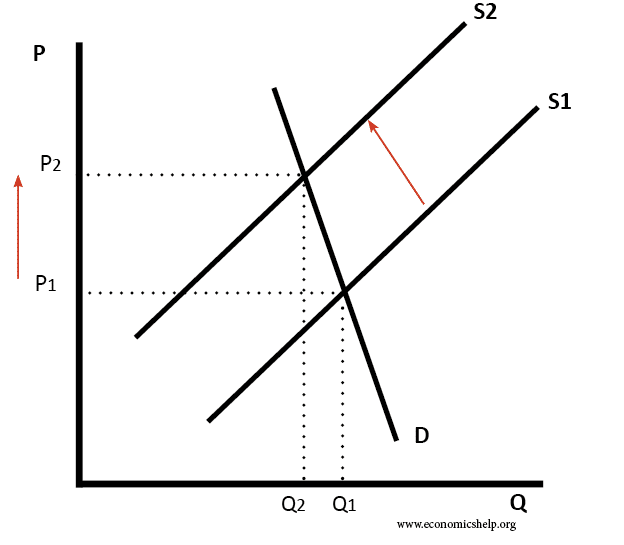

## Supply Decreases

- Consider the market for avocados after a drought:
  - $\downarrow S_a$
  - $\uparrow P_a$ and $\downarrow Q_a$

- The higher price:
  - Encourages consumers to conserve
  - Encourages producers to increase production where possible
  - Rations the now-scarcer good without central direction

## Supply Increases

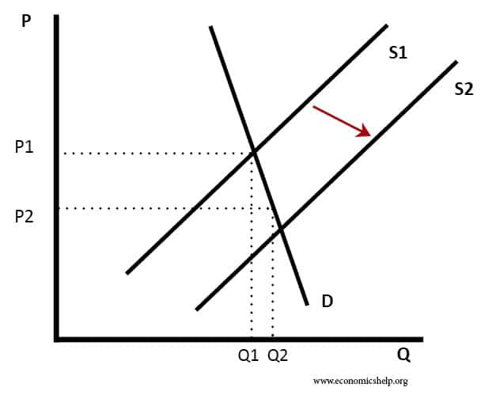

## Supply Increases

- Suppose zoning laws are relaxed,
  making it easier to build homes:
  - $\uparrow S_h$
  - $\downarrow P_h$ and $\uparrow Q_h$

- The lower price:
  - Makes housing more affordable
  - Expands access
  - Encourages greater market activity

## Supply Increases: A Common Misconception

- "Housing is more expensive where there are more homes. Therefore, building more homes makes housing more expensive."
  - This confuses **correlation** with **causation**.

- Expensive cities have high demand.
  - Increasing supply puts **downward pressure** on prices.
  
## Supply Increases: A Common Misconception

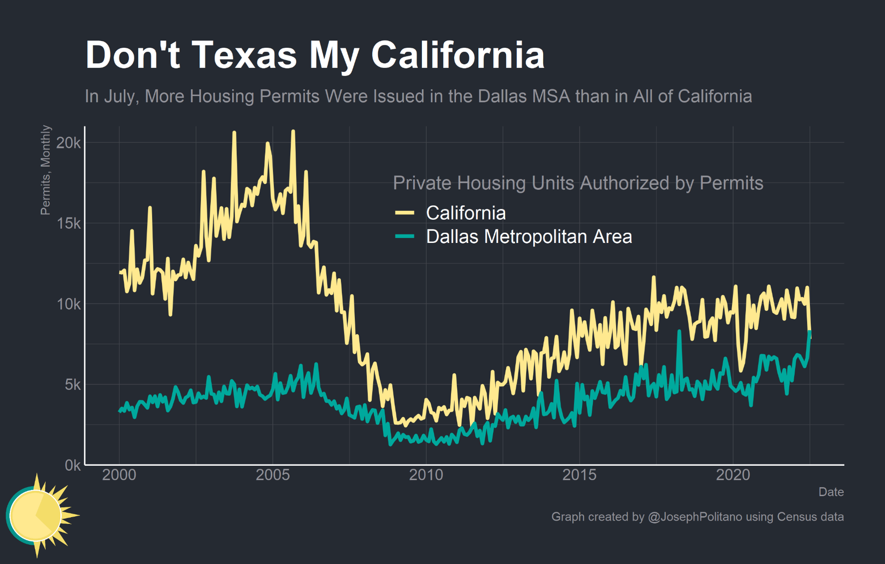

## Partial Equilibrium Predictions: Single Shift

<div style="position: relative; height: 220px;">

<div class="fragment fade-out" style="position:absolute; top:0; left:0; width:100%;">

|                | P            | Q             |
|----------------|--------------|---------------|
| S $\uparrow$   |              |               |
| S $\downarrow$ |              |               |
| D $\uparrow$   |              |               |
| D $\downarrow$ |              |               |

</div>

<div class="fragment fade-in" style="position:absolute; top:0; left:0; width:100%;">

|                | P            | Q             |
|----------------|--------------|---------------|
| S $\uparrow$   | $\downarrow$ | $\uparrow$    |
| S $\downarrow$ | $\uparrow$   | $\downarrow$  |
| D $\uparrow$   | $\uparrow$   | $\uparrow$    |
| D $\downarrow$ | $\downarrow$ | $\downarrow$  |

</div>

</div>

## Partial Equilibrium Predictions: Double Shifts

```{=html}
<div style="position:relative;padding-top:75%;height:0;">
  <iframe
    src="https://www.desmos.com/calculator/x1hzlt2pac"
    data-external="1"
    style="position:absolute;top:0;left:0;width:85%;height:65%;border:1px solid #ccc;"
    allowfullscreen>
  </iframe>
</div>
```

## Partial Equilibrium Predictions: Double Shifts

<div style="position: relative; height: 220px;">

<div class="fragment fade-out" style="position:absolute; top:0; left:0; width:100%;">

|                                  | P            | Q             |
|----------------------------------|--------------|---------------|
| S $\uparrow$; D $\uparrow$       |              |               |
| S $\uparrow$; D $\downarrow$     |              |               |
| S $\downarrow$; D $\uparrow$     |              |               |
| S $\downarrow$; D $\downarrow$   |              |               |

</div>

<div class="fragment fade-in" style="position:absolute; top:0; left:0; width:100%;">

|                                  | P             | Q             |
|----------------------------------|---------------|---------------|
| S $\uparrow$; D $\uparrow$       | ¯\\\_(ツ)\_/¯ | $\uparrow$    |
| S $\uparrow$; D $\downarrow$     | $\downarrow$  | ¯\\\_(ツ)\_/¯ |
| S $\downarrow$; D $\uparrow$     | $\uparrow$    | ¯\\\_(ツ)\_/¯ |
| S $\downarrow$; D $\downarrow$   | ¯\\\_(ツ)\_/¯ | $\downarrow$  |

</div>

</div>

## Double Shifts: Research Example

- **The Impact of the Mariel Boatlift on the Miami Labor Market** @card1990impact
  - "...[T]his paper describes the effect of the Mariel Boatlift of 1980 on the Miami labor market. The Mariel immigrants increased the Miami labor force by 7%, and the percentage increase in labor supply to less-skilled occupations and industries was even greater because most of the immigrants were relatively unskilled. Nevertheless, **the Mariel influx appears to have had virtually no effect on the wages or unemployment rates of less-skilled workers, even among Cubans who had immigrated earlier**."

## Double Shifts: Research Example

- "Cracking Down, Pricing Up: Housing Supply in the Wake of Mass Deportation" [@howard2024cracking]
  - "..[We] show that increased immigration enforcement reduces homebuilding and **drives up new construction prices**. Existing stock prices reflect some downward pressure from reduced demand, however **upward supply-side pressure dominates** in most neighborhoods... We find a significant loss of undocumented workers in construction, and that domestic workers do not provide one-to-one replacement. Instead, undocumented labor appears to complement domestic labor resulting in **net job losses for US-born workers**, especially in higher-skilled occupations."

- Deportations decrease "the employment and hourly wages of US-born individuals" [@east2023labor]

## The Role of Prices in Allocation

- Prices emerge from the voluntary interactions of buyers and sellers

- Prices allocate scarce resources toward:
  - those who value them most
  - producers who can supply them most efficiently

- No central authority decides:
  - How prices should adjust
  - Which firms handle production
  - Which consumers ultimately receive them

## Prices as Information

- Efficient allocation requires a way to **compare the value** of alternative uses of resources
  - Near infinite possible combinations of inputs for an output, but only one cost-minimizes
  - Prices provide a common measure of value

- Without prices:
  - Allocation becomes arbitrary or
  - dependent on subjective judgment or
  - reliant on incomplete information

## Markets as a Dynamic Process

- Markets are constantly **evolving**
  - A change in input costs alter supply chains spatially and temporally
  - Adjustment occurs fluidly — without central direction

- **Markets coordinate dispersed knowledge** through self interest
  - Individuals signal value through purchases
  - Firms are rewarded by responding to these signals

## Central Planning vs. Decentralized Markets

- After WWII, economists debated centralized vs. decentralized planning
  - F.A. Hayek opposed the idea of a Central Pricing Board

- @hayek1945knowledge key insight:
  - Knowledge is **dispersed**
  - No central authority can gather or process all relevant information
  
## Set up for a joke that only I find funny

:::: {.columns}

::: {.column width="40%"}
- "**Fantasy Painting Object Labeling** refers to [a meme] in which a piece of artwork, usually depicting a giant monster in battle with a small person or creature, is labeled to humorously depict everyday actions or emotions."
:::

::: {.column width="60%"}
{width="65%"}
:::

::::

## An Excellent Hayekian Meme


## Disequilibrium

- So far, we have focused on the allocative benefits of **free markets**
  - **Free market** = an economic system in which prices are determined by voluntary exchange between buyers and sellers, without external restrictions

- In reality, many markets operate under **artificial price restrictions**, such as:
  - Minimum wage laws  
  - “Price gouging” laws  
  - Rent control  
  - Zoning, etc.

## Price Floors and Price Ceilings

- Governments sometimes regulate prices by making certain transactions illegal.
  - When binding, these policies prevent the market from reaching equilibrium.

- **Price floor:** a legal minimum price.
  - Example: minimum wage.

- **Price ceiling:** a legal maximum price.
  - Example: rent control.
  
## Price Floors and Ceilings

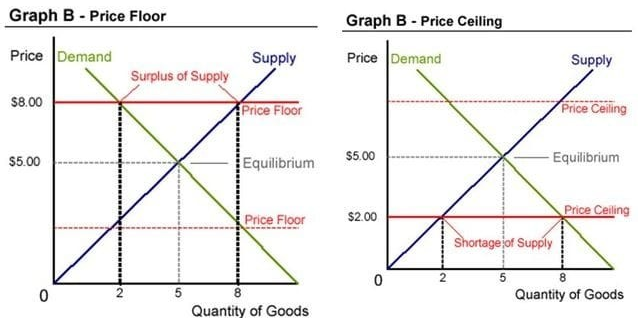

## Disequilibrium: Impacts of Price Controls

- Price controls generate both **direct** and **indirect** effects.
  - The overall impact depends on whether the price control is **binding**.

- Direct Effects
  - **Shortages** (with binding price ceilings)
  - **Surpluses** (with binding price floors)

- Indirect Effects
  - Changes in **quality**
  - Longer **wait times**
  - **Substitution** toward alternative goods
  - Emergence of **black markets**

## Should we control prices?


  
## Indirect Effects of Price Controls: Black Markets

- When binding price controls create shortages, some exchanges move **outside legal markets**, replacing regulated transactions with informal or illegal ones.
  - Market activity is likely to persist, but under less transparent and often riskier conditions.

- Reduced legal protections for participants  
  - Example: renters paying “under the table” may have limited recourse against unsafe housing conditions.
- Increased legal risk for suppliers  
  - Example: Fines, penalties, or criminal charges for violating price regulations.
  
## Disequilibrium: What does the research say?

- Min. wages increase prices, automation, unemployment, poverty and homelessness [@sabia2010minimum; @neumark2022myth; @clemens2025did; @burkhauser2025minimum; @hill2026minimum]

- Rent control (broadly defined!) 1) increases rent for everyone else, 2) leads to accelerated housing depreciation and 3) leads to less economic mobility [@randolph1988housing; @murray1991analyzing; @gyourko1990rent; @diamond2019effects; @coulson2025tenant]
  
- Black markets: 1) Anti-scalping? Higher ticket prices [@elfenbein2006anti] and 2) Craigslist erotic services? Decreased female homicides and sexual assault offenses [@cunningham2024did]

## Should we control prices?

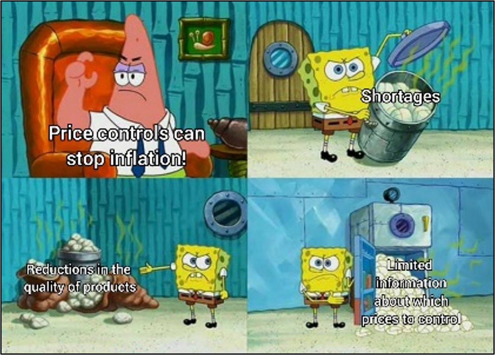

## Should we control prices?

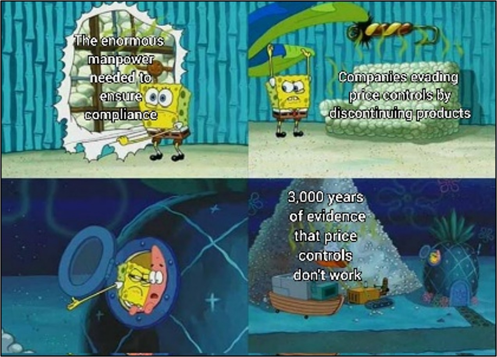

## Surplus (Welfare) and DWL

- **Consumer Surplus** = the difference between what consumers are willing to pay and what they actually pay.
- **Producer Surplus** = the difference between what producers receive and their minimum acceptable price.

- When price controls are binding:
  - Fewer goods are bought and sold.
  - Mutually beneficial trades are lost.
  - This lost welfare is known as **deadweight loss (DWL)**.

## Surplus (Welfare) and DWL

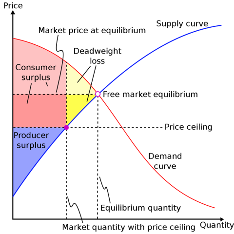

## Practice: Disequilibrium

```{=html}
<div style="display:grid; grid-template-columns: 1.1fr 0.9fr; gap: 2rem; align-items:center;">
  <div>
    <ul>
      <li class="fragment">What is the quantity demanded at P<sub>2</sub>? Quantity supplied?</li>
      <li class="fragment">Is there a shortage or surplus at this price? If so, how large is it?</li>
      <li class="fragment">What is the consumer surplus?</li>
      <li class="fragment">What is the producer surplus?</li>
      <li class="fragment">What is the deadweight loss?</li>
    </ul>
  </div>

  <div>
    
  </div>
</div>
```

## Practice: Disequilibrium

```{=html}

<div style="display:grid; grid-template-columns: 1.1fr 0.9fr; gap: 2rem; align-items:center;">
  <div>
    <ul>
      <li class="fragment">What is the quantity demanded at P<sub>1</sub>? Quantity supplied?</li>
      <li class="fragment">Is there a shortage or surplus at this price? If so, how large is it?</li>
      <li class="fragment">What is the consumer surplus?</li>
      <li class="fragment">What is the producer surplus?</li>
      <li class="fragment">What is the deadweight loss?</li>
      <li class="fragment">Are consumers (producers) made better or worse off? By how much?</li>
    </ul>
  </div>

  <div>
    
  </div>
</div>
```

## Practice: Disequilibrium

```{=html}
<div style="position:relative;padding-top:75%;height:0;">
  <iframe
    src="https://www.desmos.com/calculator/7442bfea44"
    data-external="1"
    style="position:absolute;top:0;left:0;width:85%;height:65%;border:1px solid #ccc;"
    allowfullscreen>
  </iframe>
</div>
```

## References
