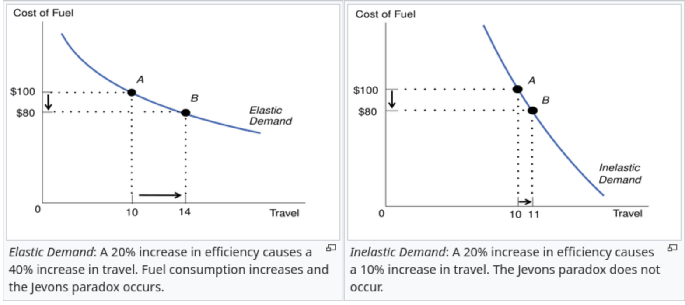

## Jevons Paradox

- **Jevons Paradox**: When technological improvements make a good or service cheaper or more efficient, total usage can increase — not decrease.

- Efficiency ↓ cost of use
- Lower cost → higher quantity demanded
- If demand is elastic, total usage rises

- Originally observed in coal:
  - More efficient steam engines
- Lower effective cost of coal
- Total coal consumption increased

## Jevons Paradox

## Jevons Paradox

- Example: ATMs and bank tellers
- ATMs reduced routine transaction costs
- Branches became cheaper to operate
- Banks opened more branches
- Tellers shifted toward customer service & advisory roles

- Why didn’t teller employment immediately fall?
  - Lower cost → expanded demand for banking services
- Automation substituted for *some* tasks
- But complemented higher-skill tasks

## Induced Demand

- When expanding supply lowers the cost of use, quantity demanded increases — often offsetting the intended benefit.

- Transportation example:
  - Expanding highways ↓ travel time
- Lower travel time = lower “price” of driving
- More people choose to drive

- Empirical evidence: @goodwin1996empirical
- Short run elasticity ≈ −0.5
- Long run elasticity ≈ −1.0
- A 1% decrease in travel time → 1% increase in traffic

## Induced Demand: Why This Happens

- Adding road capacity shifts supply right:
  - ↓ travel time
- ↓ effective cost of driving
- ↑ quantity demanded

- Over time:
  - People move farther from work
- More discretionary trips occur
- Development patterns adjust

- Result: Congestion returns.

## Induced Demand: Research Example

- "**The Fundamental Law of Road Congestion: Evidence from US Cities**" @duranton2011fundamental
- "We investigate the effect of lane kilometers of roads on vehicle-kilometers traveled (VKT) in US cities. **VKT increases proportionately to roadway lane kilometers** for interstate highways and probably slightly less rapidly for other types of roads. The sources for this extra VKT are increases in driving by current residents, increases in commercial traffic, and migration. Increasing lane kilometers for one type of road diverts little traffic from other types of road. We find no evidence that the provision of public transportation affects VKT. We conclude that increased provision of roads or public transit is unlikely to relieve congestion."

## References
