## Taxes: What Taxes Do

- Taxes create a **wedge** between the price consumers pay and the price sellers receive.  
- They are most commonly modeled as a *decrease* in either supply or demand.  
  - In both cases, they cause a **transfer of surplus** from consumers and producers to the government.
- The size of the tax equals the **vertical distance** between the supply and demand curves:  
  - $P_b$: price paid by buyers  
  - $P_s$: price received by sellers  

## Taxes: Supply and Demand Representation

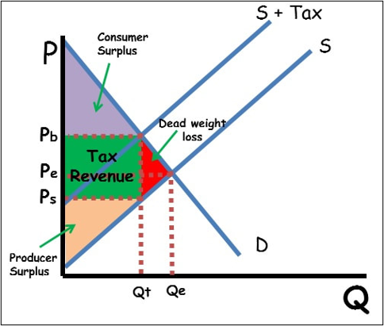

## Taxes: Tax Incidence (Who Bears the Burden?)

- **Tax incidence** refers to how the burden of a tax is divided between buyers and sellers.  
- It is measured by how much each side’s price changes relative to the **pre-tax equilibrium price**.  
- Tax incidence depends on **elasticity**:  
  - The side of the market that is *less elastic* (less responsive to price changes) bears *more* of the tax burden.
  
## Taxes: Tax Incidence (Who Bears the Burden?)

"Tariffs raise the prices of goods made at home, not just the imports they tax -- an effect that standard pass-through estimates largely miss. Studying the 2025-26 U.S. tariffs, **we find that about 26 percent of the tariff increase passes through to consumer prices**. These estimates are measured relative to less-exposed goods and hold aggregate conditions fixed. The direct effect accounts for 64 percent of this increase, as **tariffs raise the consumer prices of foreign varieties of a good**. The remaining 36 percent arises indirectly -- **tariffs raise the cost of imported inputs used by U.S. producers**, and domestic producers raise their markups because they face less competition from higher-priced imports. The direct effect passes through quickly, since tariffs raise import prices almost immediately, but the indirect effect takes nine to twelve months to work its way through supply chains..." @amiti2026anatomy

## Taxes: Tax Incidence (Who Bears the Burden?)

"We evaluate the effect of California's 11 percent excise tax on firearms, introduced in July 2024, on retail prices. Using price quotes for 48 popular firearms from over 2,200 licensed dealers, we compare California prices to those in other states and to pre-tax trends. **We find that prices in California increase by about 10% in response to the 11% tax**. Results are consistent across gun types and show no evidence of border spillovers. These findings indicate that firearm excise taxes can effectively raise consumer prices." @drango2025california

## Taxes: Visualizing Tax Incidence

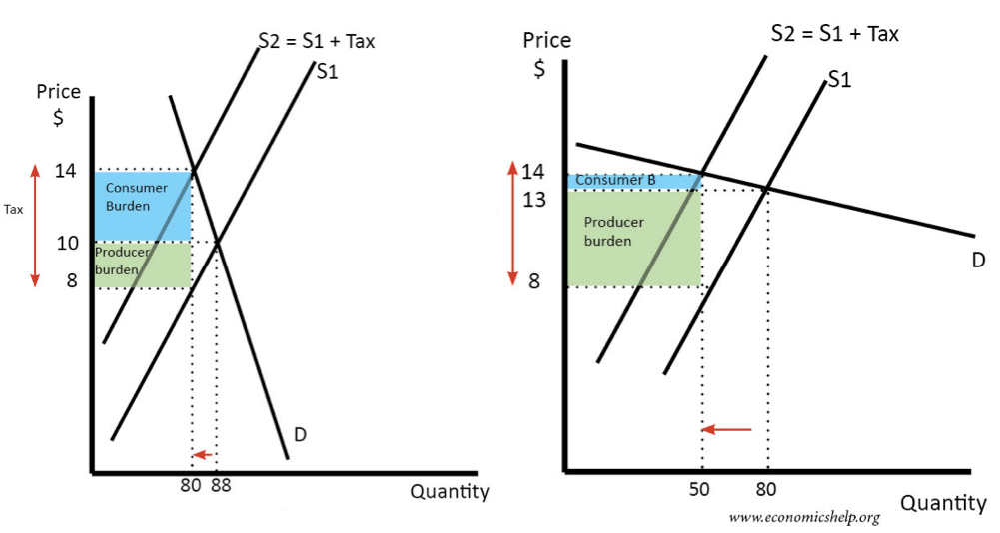

## Taxes: Visualizing Tax Incidence

```{=html}
<div style="position:relative;padding-top:75%;height:0;">
  <iframe
    src="https://www.desmos.com/calculator/7597009ca0"
    data-external="1"
    style="position:absolute;top:0;left:0;width:85%;height:65%;border:1px solid #ccc;"
    allowfullscreen>
  </iframe>
</div>
```

## Taxes: Elasticities and “Who Benefits?”

- Whether “tax cuts help the rich” depends on the relative elasticities of supply and demand.  
  - If **supply is more elastic** than demand, **consumers** benefit more from a tax cut.  
  - If **demand is more elastic** than supply, **producers** benefit more.

## Taxes: Elasticities and “Who Benefits?”

- **Tax cuts on medical companies** may benefit *patients* more than firms.  
  - Patients bear much of the tax burden because demand for healthcare is highly inelastic — people can’t easily substitute away from treatment.

- **Tax cuts on rental properties** often benefit *landlords* more than tenants.  
  - Housing supply is relatively inelastic (you can’t quickly make new apartments), while renters can adjust over time, allowing landlords to keep most of the benefit through higher profits rather than lower rents.

## Taxes: Elasticities and “Who Benefits?”

- **Tax cuts on jet fuel** often **benefit airlines** more than passengers.
  - Air travel demand is fairly elastic (people can choose not to fly), while short-run supply is inelastic (planes and routes are fixed). Airlines end up keeping most of the savings.

- **Tax incentives for movie studios or sports teams** often benefit *the firms themselves* rather than local workers or fans.  
  - Labor supply in these specialized industries is more elastic, so most of the gains accrue to the producers.

## Taxes: Efficiency vs. Equity

- A tax on **stock transactions** (like a capital gains tax or a financial transaction tax) can fall differently depending on the elasticity of capital supply and demand:
  - If investors can easily move their money elsewhere (highly elastic capital supply),
  - then firms and workers ultimately bear more of the tax burden through lower stock prices, reduced investment, and lower wages.

## Taxes: Efficiency vs. Equity

- Taxes on goods with **elastic** demand or supply create *larger* deadweight loss (DWL) and raise *less* revenue.  
- Taxes on **inelastic** goods (few substitutes) create *smaller* DWL and raise *more* revenue.  
  - For example: taxes on **housing** or **cigarettes** are less distortionary than taxes on **fashion items**.  

## Taxes: Efficiency vs. Equity

- However, taxing inelastic goods raises **equity concerns**:  
  - Economics can tell us which taxes are most **efficient** (*positive* analysis),  
  - but not which are **fair** or **just** (*normative* analysis).  
  - ⇒ The classic **Efficiency vs. Equity Tradeoff**.

## Taxes: DWL vs. Tax Revenue

```{=html}
<div style="position:relative;padding-top:75%;height:0;">
  <iframe
    src="https://www.desmos.com/calculator/7597009ca0"
    data-external="1"
    style="position:absolute;top:0;left:0;width:85%;height:65%;border:1px solid #ccc;"
    allowfullscreen>
  </iframe>
</div>
```

## Taxes: (Own-Price) Elasticity

$e = \dfrac{\% \Delta q}{\% \Delta p} = \dfrac{\frac{q_2 - q_1}{q_1}}{\frac{p_2 - p_1}{p_1}}$

- "For every 1% change in price, how much does quantity change by?"
  - $e < 1:$  **inelastic** (quantity responds less than price)  
  - $e > 1$: **elastic** (quantity responds more than price)
  - $e \approx 0$: **highly inelastic** (almost no quantity response)
  
## Taxes: Cross-Price Elasticity

$e_{xy} = \dfrac{\%\ \Delta Q_x}{\%\ \Delta P_y}$

- “For every 1% change in the **price of good Y**, how much does the **quantity demanded of good X** change?”
  - $e_{xy} > 0$: **substitutes** — when the price of Y rises, demand for X increases  
  - $e_{xy} < 0$: **complements** — when the price of Y rises, demand for X decreases  
  - $e_{xy} = 0$: **unrelated** — no relationship between the goods

## Taxes: Research

@cotti2022effects:
> “We estimate the effect of e-cigarette tax rates on e-cigarette prices, e-cigarette sales, and sales of other tobacco products using NielsenIQ Retail Scanner data from 2013 to 2019. We find that 90% of e-cigarette taxes are passed on to consumer retail prices…”

- **Question:** Which side of the market is more elastic — supply or demand?
  - **Answer:** *Supply.*
    - Producers pass along most of the tax to consumers, implying that supply is relatively inelastic compared to demand.

## Taxes: Research

@cotti2022effects:
> “…We then estimate reduced form and instrumental variables regressions to examine the effects of e-cigarette and cigarette taxes and prices on sales. We calculate an e-cigarette own-price elasticity of -2.2 and a particularly large elasticity of demand for flavored e-cigarettes…”

- **Question:** What does this elasticity tell us about how consumers respond to taxes on e-cigarettes?
  - **Answer:** *Demand is highly elastic.*
    - A 1% increase in price leads to about a 2.2% drop in sales — meaning consumers are very responsive to price changes, especially for flavored products.

## Taxes: Research

@cotti2022effects:
> “Further, we document a cigarette own-price elasticity of -0.4 and positive cross-price elasticities of demand between e-cigarettes and cigarettes...”

- **Question:** What does a positive cross-price elasticity between e-cigarettes and cigarettes imply?
  - **Answer:** *They are economic substitutes.*
    - When e-cigarette prices rise (due to taxes), cigarette consumption increases — showing that consumers substitute toward traditional cigarettes when vaping becomes more expensive.

## Subsidies: What Subsidies Do

- Subsies create a **wedge** between the price consumers pay and the price sellers receive.
- They are most commonly modeled as an *increases* in either supply or demand.  
  - In both cases, they cause a **transfer of surplus** from the government to consumers and producers.
- The size of the subsidy equals the **vertical distance** between the supply and demand curves:  
  - $P_b$: price paid by buyers  
  - $P_s$: price received by sellers

## Subsidies: DWL

- Like taxes, **subsidies create deadweight loss (DWL)**  
  - Instead of discouraging consumption, they **encourage it beyond the efficient level**

## Subsidies: DWL

- By **raising the price producers receive** while **lowering the price consumers pay**, subsidies:  
  - **Distort relative prices**, signaling producers to expand output and consumers to overconsume scarce resources  
  - **Undermine comparative advantage**, for example: it is inefficient to subsidize college-educated farmers who produce **corn in the U.S. Midwest** (where land and fertilizer are heavily subsidized) when similar crops could be grown **more efficiently in parts of South America** with lower opportunity costs and more favorable climates

  
## Subsidies: DWL

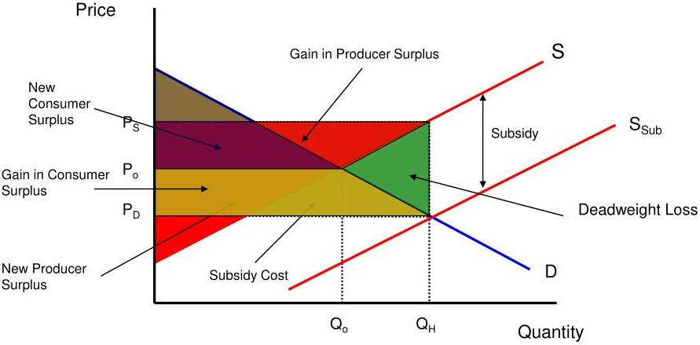{fig-align="center" width=100%}
  
## Subsidies: DWL vs. Gov. Spending

```{=html}
<div style="position:relative;padding-top:75%;height:0;">
  <iframe
    src="https://www.desmos.com/calculator/7597009ca0"
    data-external="1"
    style="position:absolute;top:0;left:0;width:85%;height:65%;border:1px solid #ccc;"
    allowfullscreen>
  </iframe>
</div>
```

## Externalities

- **Externalities** = spillover effects of an activity that influence the well-being of third parties  
  - Social Cost = Private Cost + **External Cost**  
  - Social Benefit = Private Benefit + **External Benefit**  

- Prices serve as **dynamically efficient signals** and incentives that maximize societal welfare*  
  - Market supply and demand reflect only the **private** costs and benefits  
  - *...so long as no external costs or benefits are associated with consumption or production*

## Negative Externalities

- **Negative externalities** occur when the **social cost** of a transaction exceeds the **private cost**  
  - In other words, when costs are borne by individuals **outside** the market  

- Examples include:  
  - Pollution’s effect on global temperatures when consuming electricity  
  - Spreading illness by going out in public while sick  
  - Noise and congestion from transportation choices
  
## Negative Externalities

"Taylor Swift's Eras Tour is the highest-grossing concert tour in history, with the average attendance of each concert exceeding that of the Super Bowl. While host cities largely welcome the economic activity that accompanies these events, a noted potential drawback is the effect on local air quality.... We find that, relative to baseline levels,**Eras Tour concerts were associated with statistically and economically significant increases in ozone and PM2.5 concentrations that began before and persisted after the concert day.**..." @leguizamon2026estimating

## Negative Externalities

"We provide the first causal evidence on how long-term exposure to fine particulate matter (PM2.5) at contemporary ambient levels contributes to the development of chronic disease in a young, initially healthy population. Our analysis links detailed personnel records for roughly 150,000 U.S. Army soldiers to high-resolution annual measures of PM2.5... [They are] required to relocate based on the needs of the Army, which provides us with quasi-random variation in initial duty-station assignments that we use as an instrument for average annual pollution exposure over a soldier’s career. **We find that sustained PM2.5 exposure substantially increases circulatory disease, particularly hypertension**..." @graffzivin2026effects

## Positive Externalities

- **Positive externalities** occur when the **social benefit** of a transaction exceeds the **private benefit**  
  - In other words, when benefits extend to individuals **outside** the market  

- Examples include:  
  - The creation of technologies like the internet, where inventors capture only a fraction of the total social value  
  - The aesthetic and ecological value of lavender fields  
  - Education, which benefits not only the student but also society through higher productivity, civic engagement, and innovation

## “Internalize the Externality”

- A free market will **overproduce** goods with **negative** externalities and **underproduce** goods with **positive** externalities  
  - Deadweight loss (DWL) arises from over- or under-production relative to the socially optimal level  
- A **Pigouvian tax (or subsidy)** corrects this inefficiency  
  - Taxes (subsidies) equal to the external cost (benefit) shift the market toward the **socially optimal** level of output and consumption

## “Internalize the Externality”

```{=html}
<div style="display:flex; justify-content:center; align-items:flex-start; gap:24px;">
  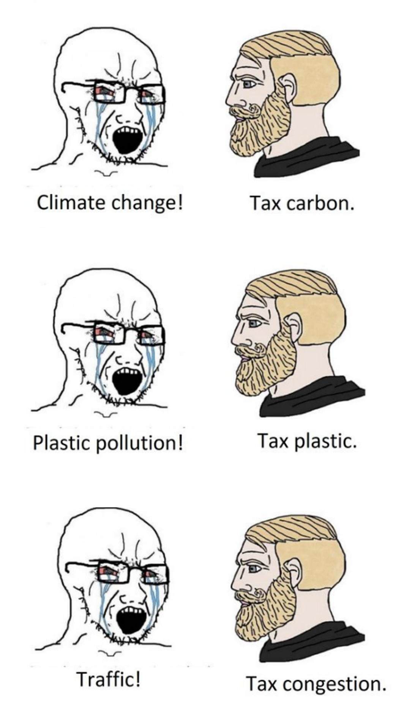
  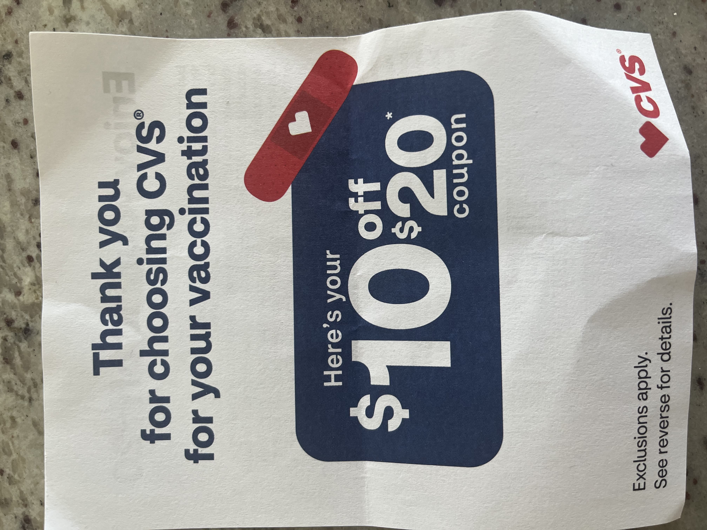
</div>

```

## “Internalize the Externality”: Modeling Externalities

```{=html}
<div style="position:relative;padding-top:75%;height:0;">
  <iframe
    src="https://www.desmos.com/calculator/6d072554e7"
    data-external="1"
    style="position:absolute;top:0;left:0;width:85%;height:65%;border:1px solid #ccc;"
    allowfullscreen>
  </iframe>
</div>
```

## What counts as an externlity?

- What counts as an externality and what doesn’t?
- Theme: Many “harms” are just price effects (pecuniary), not non-internalized costs.

## What counts as an externlity?

- Example 1:
  - You buy the last candy bar on the shelf.
  - Did you impose an external cost on others who wanted it? **No.**
  - This is **rivalry in consumption**: if I consume a unit, you can’t consume the same unit.
  - Outcome determined by **supply & demand** and willingness to pay (or arrive first).
  - No third-party harm beyond **not getting the item**—that’s a normal market outcome.

## What counts as an externlity? 

- Example 2: Choosing a Tesla over a Ford
  - You buy a Tesla instead of a Ford.
  - External cost on Ford because it lost a sale? **No.**
  - That’s **competition**: firms win customers by improving quality or lowering price.
  - Again: standard **supply & demand**, not an externality.

## What counts as an externlity? 

- Example 3: AI Data Centers & Electricity Prices
  - LLM models use lots of electricity → raises **demand for electricity** → higher prices.
  - This is a **price (pecuniary) effect**: others face a higher market price, but no third party is directly harmed outside of the price mechanism.
  - Bidding up a price (art auctions, hot housing markets, scarce GPUs) isn’t an externality.
  - **Higher prices signal scarcity and value**; they allocate goods to higher WTP users.

<!-- ## Positive Externalities of New Technology -->

<!-- - **Profits incentivize innovation** — firms develop new technologies to gain a competitive edge.   -->

<!-- - However, in some cases, **competition can discourage innovation**, especially when:   -->
<!--   - Other firms can **quickly copy** a new idea, or   -->
<!--   - The innovation requires **large fixed-cost investments** that are hard to recoup.   -->

<!-- - One policy solution is to **extend intellectual property (IP) rights**, which grant inventors the **exclusive legal right** to make, use, or sell their invention for a limited time.   -->

<!-- ## Positive Externalities of New Tech -->

<!-- - When fixed costs are high, subsidies can be **extremely** expensive -->

<!-- - Often firms care about the rate of return: -->
<!--   - $RR = \frac{Revenus}{Costs} - 1$ -->
<!--   - $Revenue = Price \times Quantity$ -->
<!--   - $Costs = \text{Fixed Costs} + \text{Variable Costs}$ -->

<!-- - Suppose: $RR_{pfizer} = (\$10 * 100b) / (\$14b + \$9.5 * 100b) - 1 \approx 3.73%$ -->

<!-- ## Positive Externalities of New Tech: Hypothetical -->

<!-- ```{r} -->
<!-- #| echo: false -->
<!-- #| warning: false -->
<!-- #| message: false -->

<!-- q <- seq(1e9, 1e11, 1e9)  # from 1 billion to 100 billion, step of 1 billion -->
<!-- p <- 10 -->
<!-- fc <- 14000000000 -->
<!-- vc <- 9.5 -->

<!-- rr <- ((p * q) / (fc + vc * q) - 1) * 100 -->

<!-- par(mar = c(4.5, 4.5, 1, 1)) -->
<!-- plot(q, rr, type = "l", lwd = 4, -->
<!--      ylab = "Rate of Return", xlab = "Vaccines (billions)", -->
<!--      cex.axis = 1.25, cex.lab = 1.5, xaxt = 'n') -->

<!-- axis(1, at = seq(1e9, 1e11, 1e10),  # ticks every 10 billion -->
<!--      labels = seq(1, 100, 10), cex.axis = 1.25) -->
<!-- ``` -->

## Public Goods Problems

```{=html}
<style>
  .two-col {
    display: flex;
    gap: 2rem;               /* space between columns */
    align-items: center;     /* vertical alignment */
  }
  .two-col > div {
    width: 50%;              /* each column takes 50% width */
  }
  /* Optional: stack on narrow screens */
  @media (max-width: 900px) {
    .two-col { flex-direction: column; }
    .two-col > div { width: 100%; }
  }
  /* Optional: make images scale nicely */
  .two-col img {
    max-width: 100%;
    height: auto;
    border-radius: 15px;
    display: block;
  }
</style>

<div class="two-col">
  <div>

  <p><strong>Public goods</strong> are <strong>non-excludable</strong> and <strong>non-rival</strong> in consumption.</p>

  <ul>
    <li><strong>Excludable</strong> → You can prevent non-payers from using it.</li>
    <li><strong>Rival</strong> → One person’s use reduces availability for others.</li>
    <li>Because public goods are <strong>non-excludable</strong> and <strong>non-rival</strong>, markets often 
    <strong>fail to provide them efficiently</strong>.</li>
  </ul>

  </div>
  <div>

  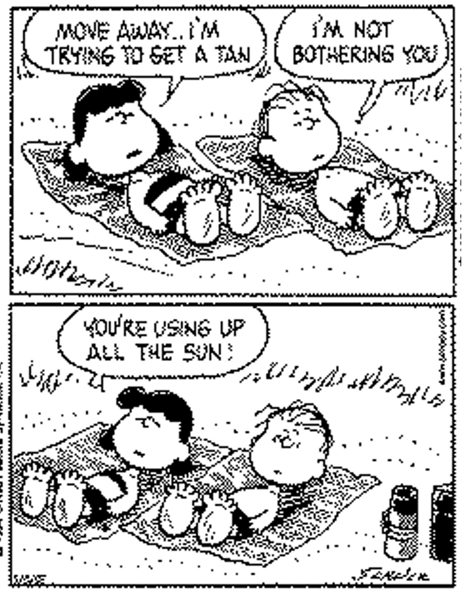

  </div>
</div>

```

## Public Goods Problems

| Type of Good  | Excludable  | Rival  |
|---------------|-------------|--------|
| Private Good  | ✓           |      ✓ | 
| Public Good   |           ✗ |    ✗   |  
| Club Good     | ✓           | ✗      |    
| Common Good   | ✗           |      ✓ | 

## Public Goods Problems: Examples

| Category | Examples |
|-----------|-----------|
| Private Goods |  |
| Common Goods  |  |
| Club Goods    |  |
| Public Goods  |  |

## Public Goods Problems: Examples

| Category | Examples |
|-----------|-----------|
| Private Goods | Phones, Groceries, Shoes |
| Common Goods  | Roads, Fish, Parks |
| Club Goods    | Security, Wi-Fi, Concerts |
| Public Goods  | Gravity, National Defense, Disease Control |

## Sources of Public Goods Problems

```{=html}
<div class="two-col">
  <div>

  <p>Some key sources of <strong>public goods problems</strong> include:</p>

  <ul>
    <li><strong>Non-excludability</strong> encourages <strong>free riding</strong> — individuals benefit without contributing.</li>
    <li><strong>Non-rivalry</strong> makes it <strong>inefficient to exclude anyone</strong>, even if they don’t pay.</li>
  </ul>

  </div>
  <div>

  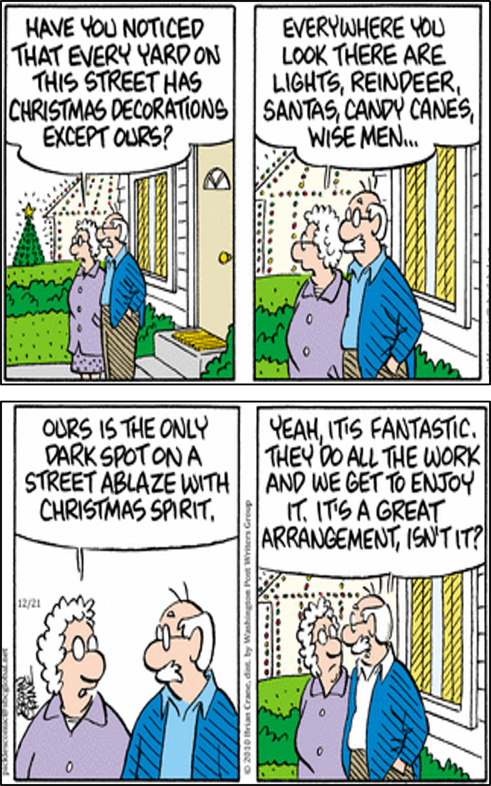

  </div>
</div>
```

## The Tragedy of the Commons

- **The Tragedy of the Commons** describes the tendency of any **non-excludable resource** to be **overused and under-maintained** when individuals act in their own self-interest.
  - Each user has an incentive to extract as much value as possible.  
  - Because no one owns the resource, **no one bears full responsibility** for its upkeep.  
  - Examples include **traffic congestion**, **overfishing**, and **air pollution**.  

## The Tragedy of the Commons

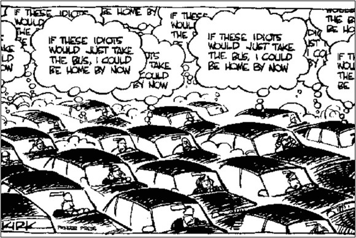

## Managing Common Resources

- **Example:** In the case of **tuna**, the **stock of fish** is the **common resource** — *rival but non-excludable* (especially in international waters)

- When fish stocks become depleted, governments may impose **shorter fishing seasons**.  
  - At one point, there were only **four days per year** to fish for king crabs.  
  - This creates perverse incentives — fishermen invest in **larger, faster boats**, leading to **continued overfishing**.  

## Managing Common Resources

::: {.columns}

::: {.column width="60%"}

- **Solution? Cultural norms**
  - Linked to **Nobel laureate Elinor Ostrom**, who showed that **community norms** can sustain common resources.
  - Works best in **small, self-governing communities** where social pressure enforces cooperation.

:::

::: {.column width="40%"}


:::

:::

## Coase Theorem

- **Efficient outcomes** can occur when:  
  - Transaction costs are **low**  
  - Property rights are **clearly defined**  
- Example:  
  - If the **town** owns the river, the **paper factory** can **pay to pollute**.  
  - If the **factory** owns the rights, the **town** can **pay for cleaner water**.

## Coase Theorem

"International transboundary air pollution poses a significant threat to the global economy and health, yet conventional economic analyses seldom incorporate this phenomenon. By integrating transboundary particle trajectory data with individual-level mortality and emergency department visit records, **we find that air pollution from China significantly increases mortality and morbidity in South Korea**. We evaluate the spillover benefits of recent Chinese environmental regulations and find that a country's environmental policies could generate substantial hidden benefits for neighboring countries. Finally, we demonstrate that China's potentially strategic reductions in pollution could have undermined these benefits, highlighting the implications for additional gains through **Coasian bargaining**." @heo2025international

## Managing Common Resources

- **Example:** The **stock of tuna** is a **common resource** — *rival but non-excludable* (especially in international waters).  

- To address overuse, many governments establish **Individually Transferable Quotas (ITQs)**:  
  - These **create property rights** for a specific **tonnage of fish**.  
  - Fishermen are **incentivized to maintain the long-term value** of their quota.  
  - Encourages **sustainable management** rather than short-term overfishing.  

- Similar idea: **Cap-and-Trade systems**, which apply the same property-rights principle to **pollution permits**.

## Why Not Just Ban It?

- If **pollution** is a **negative externality**, it might seem logical to simply **ban it altogether**.
  - However, **some level of pollution** is an unavoidable byproduct of **productive economic activity**.  
  
- The goal is **not zero pollution**, but the **socially optimal level** — where the **marginal benefit of production** equals the **marginal social cost** of pollution.  

- Think of it like **speed limits** -- the **optimal speed limit isn’t zero**, even though higher speeds increase risk.  
  - We balance **safety and efficiency** — just as we balance **environmental protection and economic output**.

## Introduction to Government Failure

- **First lesson of economics:**  
  -There is never enough of anything to fully satisfy everyone.

- **First lesson of politics:**  
  -Ignore the first lesson of economics.

- **Government failure** occurs when government intervention in the economy produces outcomes that are **less efficient or less desirable** than what would have occurred without it

## Causes of Government Failure

- Government can be **inefficient relative to the free market** when:
  - **Voter biases** distort preferences for certain policies.  
  - **Shared beliefs** lead to misplaced confidence in the government's ability to solve problems.  
  - **Political incentives** make seeking favors or influence more profitable than market competition.

## Biases in Reasoning

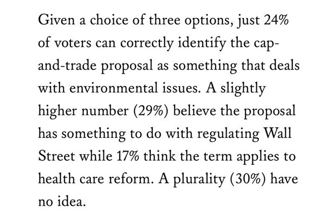

@bishophenchman2009captrade

## Biases in Reasoning

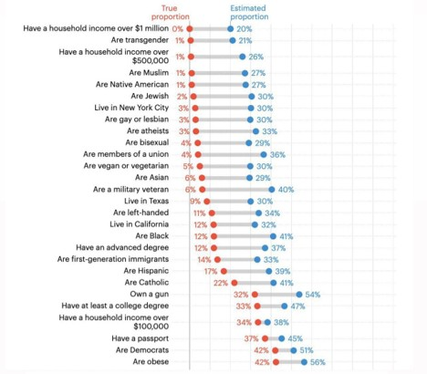{fig-align="center" width=100%}

@orth2022millionaires

## Biases in Reasoning

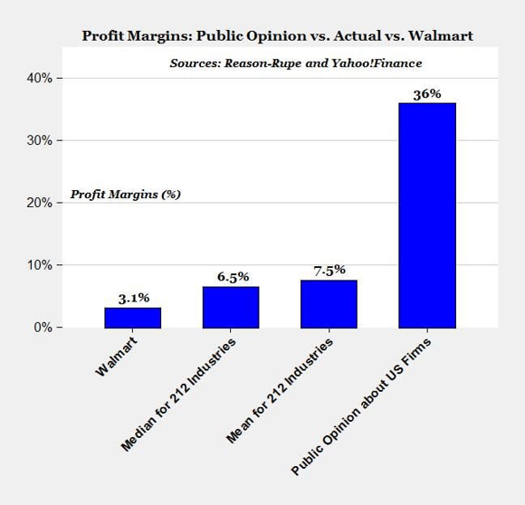{fig-align="center" width=100%}

@caplan2008myth

## Biases in Reasoning

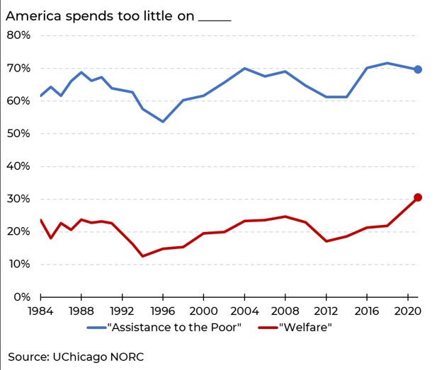

## Rational Ignorance

- **Rationality** means that individuals choose the options that best advance their goals at the lowest possible cost.  
  - We assume voters make decisions by comparing the **costs and benefits** of becoming informed and voting.

- When uncertainty exists, individuals weigh **expected benefits** against **expected costs**:  
  - Since a single vote is highly unlikely to change an election outcome, the expected benefit of voting is near 0.
  - $E(\text{Benefit}) = P(Swing Vote) \times \Delta U(CandidateWins) = 0 \times \Delta U \approx 0$
  - Therefore, voters have an incentive to **limit the time and effort spent learning about politics** — a phenomenon known as *rational ignorance*.
  
## Rational Ignorance

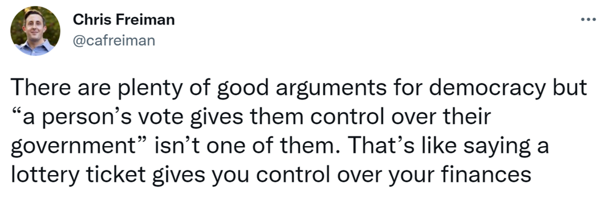

## Voter Biases

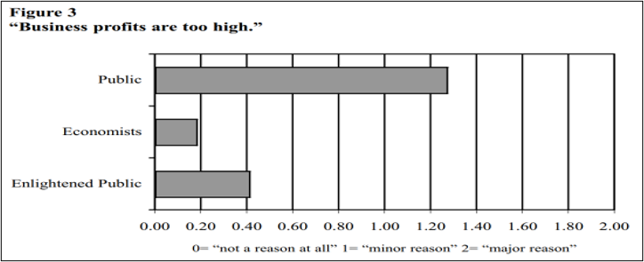

@caplan2008myth

## Voter Biases

- The public is **6.5× more likely than economists** to believe that large business profits restrain the economy.  
  - On average, people **overestimate typical business profit rates by more than sevenfold**.

- Many view profit as a **transfer from people to businesses**, whereas economists see it as the **engine of progress**:  
  - “If you want to get rich, then you have to do something people will pay for.”  
  - Profits create incentives to **cut production costs**, **shift resources** to higher-valued uses, and **innovate** new products and services.

## Voter Biases

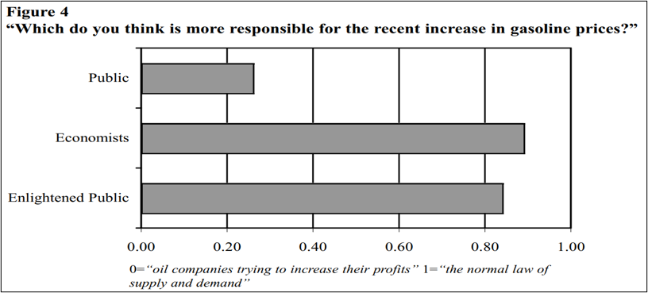

@caplan2008myth

## Voter Biases

- The public is **3.5× more likely** than economists to believe that **corporate greed**, rather than **supply and demand**, explains changes in gas prices.

- In reality, **everyone is motivated by self-interest** — what matters is **who can act on it and when**, which depends on **changes in supply, demand, and their elasticities**.
  - “Blaming higher prices on corporate greed is like blaming gravity for plane crashes.”

## Voter Biases

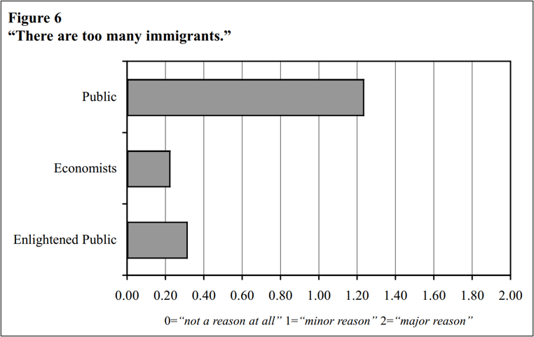

@caplan2008myth

## Voter Biases

- Voters are **5× more likely than experts** to believe the economy would improve with **fewer immigrants**.
  - Within the "economic" framwork, **foreigners** are simply people born on the other side of **arbitrary political boundaries**.

- **Immigration** increases both the **supply** and **demand** for local goods and services:  
  - When the rise in **labor demand** exceeds the rise in **labor supply**, the result is **more jobs and higher wages**.

## Voter Biases

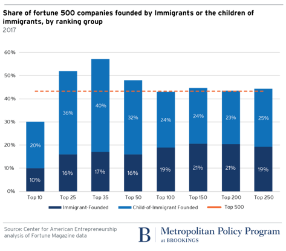

## Voter Biases

- **Make-work bias:** The tendency to equate prosperity with **employment** rather than **production**.  
  - Leads people to **undervalue the benefits of conserving labor** through innovation and efficiency.

- We link **individual prosperity** to having a job, but **social prosperity** to creating value for others.  
  - “To progress is to decrease the ratio of effort to result.” — *Frédéric Bastiat*

## Voter Biases

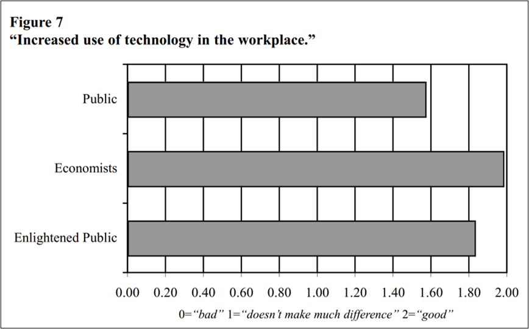{fig-align="center" width=100%}

## Voter Biases

- In **1800**, nearly **95 of every 100 Americans** worked to feed the country.  
  - By **1900**, that number fell to **40**,  
  - And **today**, it’s fewer than **3**.

- If we had **prevented efficiency gains** through technology in the 1800s, we would **not enjoy today’s living standards**.
  - Yet voters are **3× more likely than economists** to believe the economy would improve **if companies stopped laying off workers**.

## Shared “Visions” Problems

- In policymaking, people often **imagine perfect solutions** instead of choosing the **best realistic one**.

- Suppose someone proposes a **transit system powered by unicorns**:  
  - Unicorns are strong, fast, and pollution-free (they eat rainbows!)  
  - They can be created with **love, magic, and friendship** — making them cheap and abundant.

## Shared “Visions” Problems

- If everyone drew a unicorn, our drawings would likely **overlap in imagined traits**.  
  - Psychologically, these **“shared visions”** cause people to project **idealized capabilities** onto imagined solutions.

- Similarly, voters often assume government possesses **magical levels of knowledge, motivation, and competence** to design and implement perfect policy.

## Shared "Visions" Problems

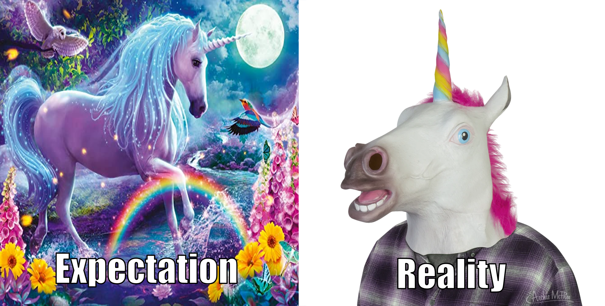{fig-align="center" width=100%}

## Rent Seeking

- **Rent-seeking** refers to gaining **unearned income through the political process** without increasing productivity.  
  - Examples include lobbying for **grants, subsidies, or tariff protection**.  
  - The term **“rent”** originates from those who **profit by owning scarce assets** (like land) rather than improving them.

## Rent Seeking

- Rent-seeking behavior is often **protectionist**, creating **barriers to entry** that limit competition and **preserve incumbent advantages**.  
  - Restricting competition allows established firms to **maintain larger market shares**.

- It operates through **dispersed costs and concentrated benefits**:  
  - The **political rewards** of catering to specific firms or industries (via campaign contributions or favors) often **outweigh the diffuse costs** imposed on taxpayers or consumers.
  
## Rent Seeking

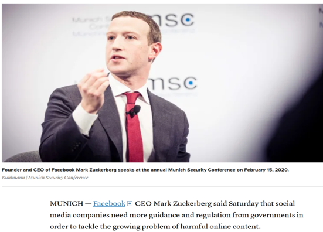{fig-align="center" width=100%}  

## Rent Seeking

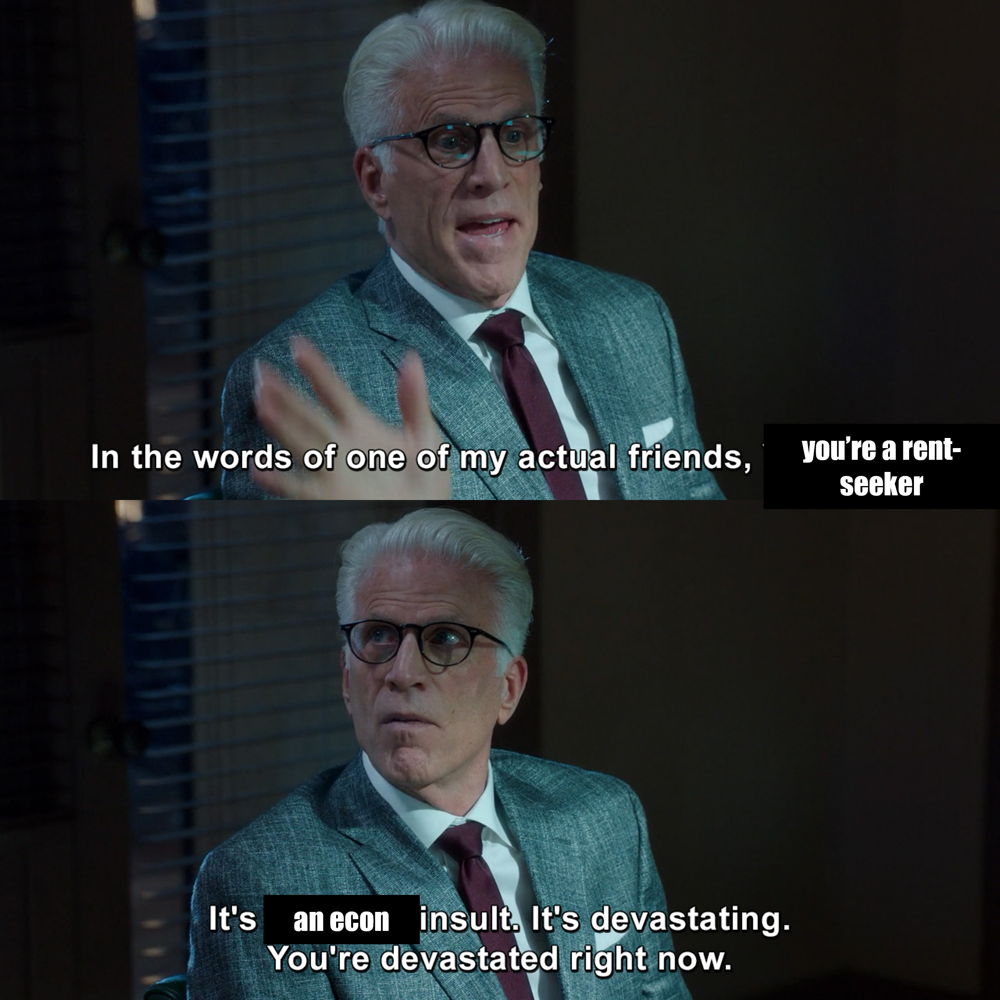{fig-align="center" width=100%}

## Rent Seeking

"The potential **uses of public resources and powers to improve the economic status of economic groups** (such as industries and occupations) are analyzed to provide a scheme of the **demand for regulation**. The characteristics of the political process which allow **relatively small groups to obtain such regulation** is then sketched to provide elements of a theory of **supply of regulation**. A variety of empirical evidence and illustration is also provided." @stigler1971economic

## Rent Seeking

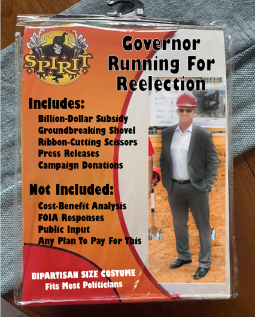{fig-align="center" width=100%}

## Rent Seeking

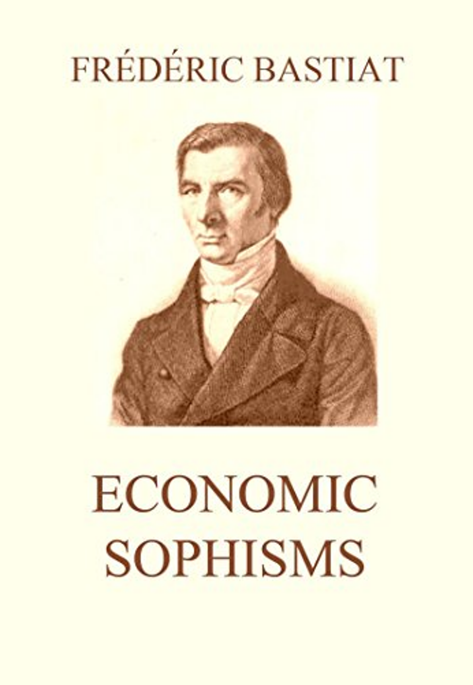{fig-align="center" width=100%}

## Rent Seeking
### Bastiat -- Economic Sophisms

*“We are suffering from the ruinous competition of a rival who apparently works under conditions so far superior to our own for the production of light that he is flooding the domestic market with it at an incredibly low price; for the moment he appears, our sales cease, all the consumers turn to him, and a branch of French industry whose ramifications are innumerable is all at once reduced to complete stagnation”*

## Rent Seeking
### Bastiat -- Economic Sophisms

*Government ought to “… require[e] the closing of all windows, dormers, skylights, inside and outside shutters, curtains, casements, bull’s-eyes, deadlights, and blinds—in short, all openings, holes, and fissures through which the light of the sun is wont to enter houses, to the detriment of the fair industries with which, we are proud to say, we have endowed the country, a country that cannot, without betraying ingratitude, abandon us today to so unequal a combat.”*

## Rent Seeking

- If the argument against the **sun** is absurd, so too are similar defenses of protection for **domestic candlemakers** against foreign competition.  
  - If French candlemakers lose business to the English, they will shift into other productive industries — and the **nation as a whole becomes wealthier** in the long run.

- **Protectionism** effectively **transfers wealth from consumers to producers**, functioning like an **unproductive tax** on society.

## Protectionism

- @flaaen2020washing

- To “protect” U.S. steel and appliance jobs, the (first) **Trump administration imposed tariffs** on steel-heavy goods.  
  - The first **1.2 million imported washing machines** were taxed at **20%**, and all additional imports at **50%**.  
  - As a result, **imports fell by over 45%**, and **prices rose by more than 20%**.  
  - The policy created roughly **1,800 new jobs** in the washer and dryer industry.

## Protectionism

- During this period, the price of **17.4 million units** rose by **\$88 each**:  
  - **Producer gains (GR):** ↑ \$82.2 million  
  - **Consumer surplus (CS):** ↓ \$1.56 billion  

- **Net cost:** \$1.46 billion per year — or about **\$811,000 per job created**.  
  - The government could have **paid each worker \$500,000 annually** and still been **\$500 million better off**.
  
## Protectionism

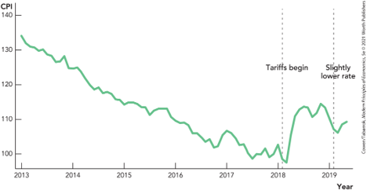

## Protectionism

```{=html}

<div class="two-col">
  <div>
  
    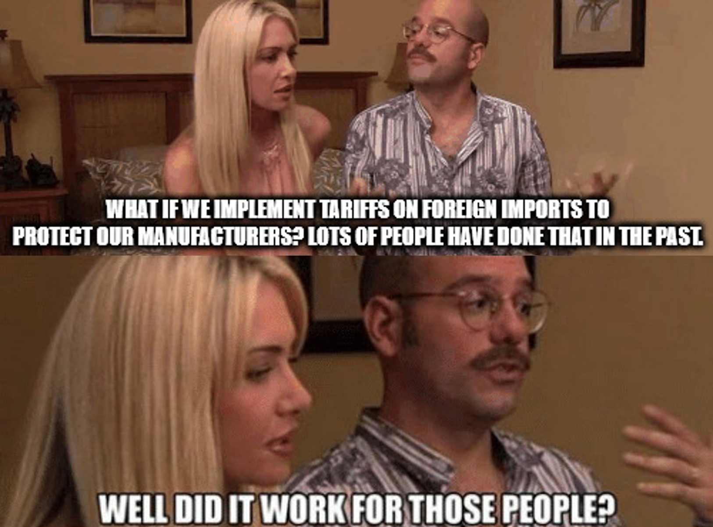

  </div>
  <div>

  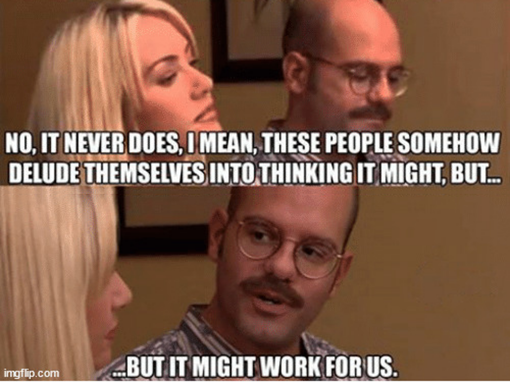

  </div>
</div>

```

## Fin

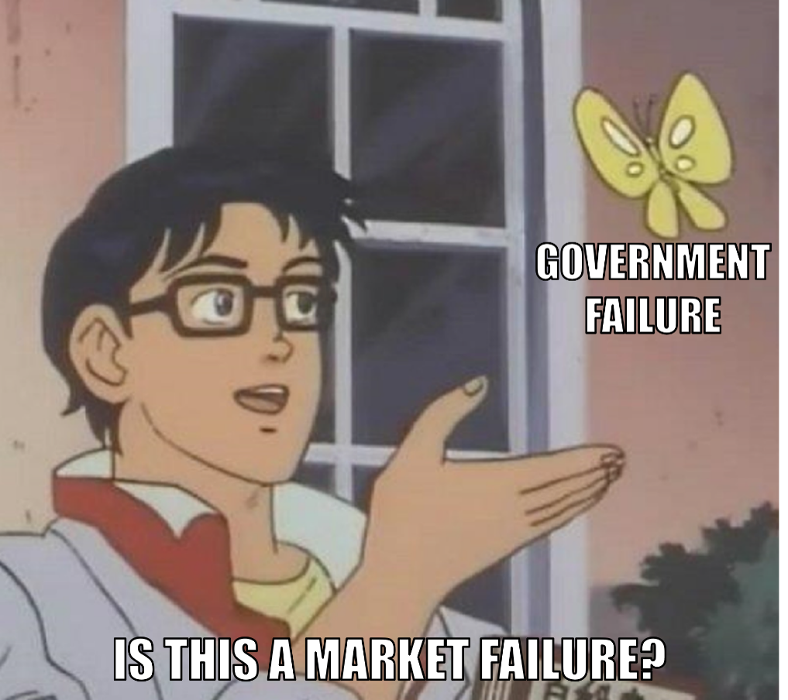{fig-align="center" width=100%}

## References
