## The Theory of the Firm

- This unit explores the theory of the firm.  

- A firm (or producer or business) combines inputs — labor, capital, land, and materials — to produce outputs.  
  - If the firm is successful, the outputs are **more valuable** than the inputs.
  
## Determinants of Firm Behavior

- The answers to key production questions depend on both production and cost conditions and on the **market structure** of the industry.  

- Market structure refers to how competitive an industry is and can be described by questions such as:
  - How much **market power** does each firm possess?  
  - How similar are products across firms?  
  - How difficult is it for new firms to enter the industry?  
  - Do firms compete primarily on price, advertising, or other product differences?

## Spectrum of Competition

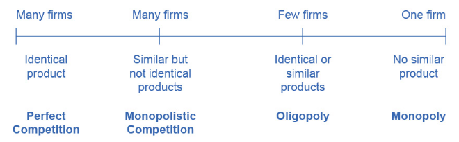

## Range in Size of U.S. Firms
### Source: U.S. Census, 2010

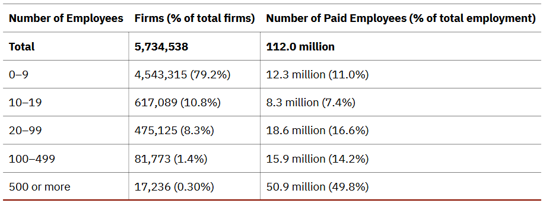

## Profit and Cost Basics

- Each business, regardless of size or complexity, tries to earn a **profit**:
  - $\pi = \text{Revenue} - \text{Costs}$
  - $\text{Revenue} = TR = P \times Q = \text{Price} \times \text{Quantity}$
  - $\text{Costs} = TC = FC + VC + OC = \text{Fixed} + \text{Variable} + \text{Opp.}$

## Explicit vs. Implicit Costs

- **Explicit costs** are out-of-pocket expenses made by the firm.  
  - Examples include **wages** paid to employees or **rent** for office space.

- **Implicit costs** represent the **opportunity cost** of using resources the firm already owns.  
  - Examples include working in the business without a formal salary, or using part of a home as retail space.  
  - Implicit costs also include **depreciation** of equipment and materials necessary for production.

## Fixed and Variable Inputs

- **Fixed inputs** are those that cannot easily be changed in the short run.  
  - For example, a **building** is a fixed input — the owner is bound by the lease until it expires.  

- **Variable inputs** can be increased or decreased easily in the short run.  
  - For instance, a pizzeria can order more ingredients or hire another worker with little delay.  

## Time Horizons

- The **short run** is the period during which at least one factor of production is **fixed**.  
  - During a lease, the pizza shop operates in the short run because it cannot change its building size.

- The **long run** is the period during which **all factors** are **variable**.  
  - Once the lease expires, the owner can relocate to a larger or smaller space.

## Accounting vs. Economic Profit

- **Accounting profit** is a cash-based measure:  
  - Total revenue minus **explicit costs** — the difference between money received and money paid out.  

- **Economic profit** equals total revenue minus **total cost**, including both **explicit** and **implicit** costs.  
  - This distinction matters because firms pay taxes (and dividends) on accounting profit, but the efficiency of decisions depends on economic profit.

## Accounting vs. Economic Profit Example

- Eryn currently works for a corporate law firm where she makes \$125k and is considering opening her own legal practice. 
  - She expects to earn \$200k per year once she establishes herself. 
  - To run her own firm, she would need an office and a law clerk.
  - Office rent: \$50k/year; law clerk: \$35k/year
  
- Accounting $\pi = \text{TR} - \text{EC} = \$200 - (\$50k + \$35k) = \$115k$
- Economic $\pi = \text{TR} - \text{EC} - \text{OC} = \$200 - (\$50k + \$35k) - \$125k = -\$10k$

## Production Functions

- Recall our factors of production are: $Q(N,L,K,E) = f(N,L,K,E)$

- Often times, we simplify the production function such that $Q(K,L)$

- The marginal product of labor (capital) measures how much additional output one more worker (piece of technology) would increase a firm's output, holding all else constant.
  - $MP_L = \frac{\partial Q(K,L)}{\partial L} \approx \frac{\Delta Q}{\Delta L}$
  
## Production Schedule: Example

| Lumberjacks | Trees | $MP_L$ |
|-------------|-------|------|
| 1           | 4     |      |
| 2           | 10    |      |
| 3           | 12    |      |
| 4           | 13    |      |
| 5           | 13    |      |

## Production Schedule: Example

| Lumberjacks | Trees | $MP_L$ |
|-------------|-------|------|
| 1           | 4     | 4    |
| 2           | 10    | 6    |
| 3           | 12    | 2    |
| 4           | 13    | 1    |
| 5           | 13    | 0    |

## Production Schedule: Example

```{r}
#| echo: false

z <- data.frame(l = 1:5, 
                trees = c(4, 10, 12, 13, 13),
                mpl = c(4, 6, 2, 1, 0))

par(mfrow = c(1, 2), mar = c(4.5, 4.5, 1, 1))

plot(z$l, z$trees, type = "l", 
     xlab = "Lumberjacks", ylab = "Trees", 
     cex.axis = 1.25, cex.lab = 1.5, lwd = 4)
plot(z$l, z$mpl, type = "l", 
     xlab = "Lumberjacks", ylab = "Marginal Product of Labor", 
     cex.axis = 1.25, cex.lab = 1.5, lwd = 4)
```

## The Law of Diminishing Marginal Product

- As more workers are added, **marginal product** may increase at first — due to specialization or efficiency gains — but eventually **decreases** as inputs become crowded or less productive.  
  - In some cases, adding more workers may have **no effect** or even a **negative effect** on total output.  

- This pattern is known as the **Law of Diminishing Marginal Product**, a key feature of **short-run production**.  
  - The idea parallels **diminishing marginal utility** in consumer theory.

## Cost Relationships

- $\text{Average Cost} = \dfrac{TC}{Q} = \dfrac{VC + FC}{Q}$  

- $\text{Marginal Cost} = \dfrac{\Delta TC}{\Delta Q} = \dfrac{\Delta VC + \Delta FC}{\Delta Q} = \dfrac{\Delta VC}{\Delta Q} = \dfrac{VC_2 - VC_1}{Q_2 - Q_1}$

## Cost Curve Example

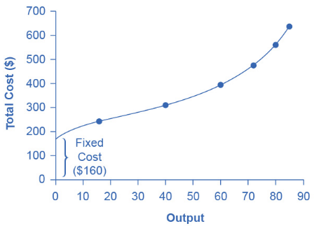

## Cost Schedule Example

```{r}
#| echo: true

z <- data.frame(
  labor = 0:7,
  quantity = c(0, 16, 40, 60, 72, 80, 84, 82),
  fixed_cost = 160,
  variable_cost = 0:7 * 80
)
z$total_cost <- z$fixed_cost + z$variable_cost
z

```

## Cost Schedule Example

```{r}
#| echo: true

z$average_cost <- z$total_cost / z$quantity
z$marginal_cost <- NA
z$marginal_cost[2:nrow(z)] <- diff(z$total_cost) / diff(z$quantity)
z

```

## Cost Curves Example

```{r}
#| echo: false

y <- z[z$labor > 0 & z$labor < 7,]
minz <- apply(y[,6:7], 1, min)
maxz <- apply(y[,6:7], 1, max)

par(mar = c(4.5, 4.5, 1, 1))
plot(y$quantity, y$average_cost, type = "l", lwd = 4,
     ylim = c(min(minz), max(maxz)),
     ylab = "Costs", xlab = "Output",
     cex.lab = 1.5, cex.axis = 1.25)
lines(y$quantity, y$marginal_cost, lwd = 4, col = "blue")
legend("topleft",
       legend = c("Average Cost", "Marginal Cost"),
       lwd = 2, col = c("black", "blue"), 
       bty = "n", cex = 1.25)

```

## Cost Schedule Example
### Change in cost per worker

```{r}
#| echo: true

z$average_cost <- z$total_cost / z$labor
z$marginal_cost <- NA
z$marginal_cost[2:nrow(z)] <- diff(z$total_cost) / diff(z$labor)
z

```

## Cost Curves Example
### Change in cost per worker

```{r}
#| echo: false

y <- z[z$labor > 0 & z$labor < 7,]
minz <- apply(y[,6:7], 1, min)
maxz <- apply(y[,6:7], 1, max)

par(mar = c(4.5, 4.5, 1, 1))
plot(y$quantity, y$average_cost, type = "l", lwd = 4,
     ylim = c(min(minz), max(maxz)),
     ylab = "Costs", xlab = "Labor",
     cex.lab = 1.5, cex.axis = 1.25)
lines(y$quantity, y$marginal_cost, lwd = 4, col = "blue")
legend("topright",
       legend = c("Average Cost", "Marginal Cost"),
       lwd = 2, col = c("black", "blue"), 
       bty = "n", cex = 1.25)

```

## Output Schedule Example

```{r}
#| echo: true

## made up data, workers and a production function
z <- data.frame(l = 1:100)
z$q <- 2*log(z$l + 4) + 2*log(max(z$l)) + 1 - 2*log(max(z$l) + 4)
z <- rbind(data.frame(l = 0, q = 0), z)

# marginal product of labor
z$mp_l <- NA
z$mp_l[2:nrow(z)] <- diff(z$q) / diff(z$l)

head(round(z, 1))

```

## Output Curves Example

```{r}
#| echo: false

y <- z[z$l > 1,]

par(mfrow = c(1, 2), mar = c(4.5, 4.5, 1, 1))

plot(y$l, y$q, type = "l",
     ylab = "Output", xlab = "Workers",
     cex.lab = 1.5, cex.axis = 1.25,
     lwd = 4)

plot(y$l, y$mp_l, type = "l",
     ylab = "Marginal Product of Labor", 
     xlab = "Workers",
     cex.lab = 1.5, cex.axis = 1.25,
     lwd = 4)

```

## Output Schedule Example

```{r}
#| echo: true

# costs (variable + fixed)
wage <- 10
z$total_cost <- z$l * wage + 1000
z$average_cost <- z$total_cost / z$q

# Marginal cost via discrete differences
z$marginal_cost <- z$total_cost / z$q
z$marginal_cost[2:nrow(z)] <- diff(z$total_cost) / diff(z$q)

## peak at the data
head(round(z, 1))

```

## Cost Curves Example #2

```{r}
#| echo: false

y <- subset(z, z$l > 0)
minz <- apply(y[,5:6], 1, min)
maxz <- apply(y[,5:6], 1, max)

par(mar = c(4.5, 4.5, 1, 1))

plot(y$q, y$average_cost, type = "l", lwd = 4, 
     ylim = c(min(minz), max(maxz)),
     ylab = "Costs", xlab = "Output",
     cex.lab = 1.5, cex.axis = 1.25)
lines(y$q, y$marginal_cost, lwd = 4, col = "blue")
legend("topleft",
       legend = c("Average Cost", "Marginal Cost"),
       lwd = 2, col = c("black", "blue"), bty = "n",
       cex = 1.25)

```

## Output Schedule Example
### Change in cost per worker

```{r}
#| echo: true

# costs (variable + fixed)
wage <- 10
z$total_cost <- z$l * wage + 1000
z$average_cost <- z$total_cost / z$l

# Marginal cost via discrete differences
z$marginal_cost <- z$total_cost / z$l
z$marginal_cost[2:nrow(z)] <- diff(z$total_cost) / diff(z$l)

## peak at the data
head(round(z, 1))

```

## Cost Curves Example #2
### Change in cost per worker

```{r}
#| echo: false

y <- subset(z, z$l > 0)
minz <- apply(y[,5:6], 1, min)
maxz <- apply(y[,5:6], 1, max)

par(mar = c(4.5, 4.5, 1, 1))

plot(y$l, y$average_cost, type = "l", lwd = 4, 
     ylim = c(min(minz), max(maxz)),
     ylab = "Costs", xlab = "Workers",
     cex.lab = 1.5, cex.axis = 1.25)
lines(y$l, y$marginal_cost, lwd = 4, col = "blue")
legend("topright",
       legend = c("Average Cost", "Marginal Cost"),
       lwd = 2, col = c("black", "blue"), bty = "n",
       cex = 1.25)

```

## Profit Margin

- $\text{Average } \pi = \dfrac{\pi}{Q} = \dfrac{TR - TC}{Q} = \dfrac{TR}{Q} - \dfrac{TC}{Q}=...$

- $...=\dfrac{TR}{Q} - \dfrac{TC}{Q} = \dfrac{P \times Q}{Q} - \dfrac{AC \times Q}{Q} = P - AC$

- $\text{Average } \pi = P - AC$

- Average profit is also known as the **profit margin** or profit per unit
  - If $P > AV$, then the firm is profitable
  - If $P > MC$, then increasing production will increase profits

## Production in the Long Run

- The **long run** refers to a time horizon in which the firm has **no fixed inputs** — all factors of production can be adjusted.  
  - In contrast, in the short run, **capital** is typically treated as **fixed**, while **labor** is variable.  

- The long run is **not a specific length of time**; it depends on the nature of the firm.  
  - For example, if a firm has a **one-year lease** on its factory, then the long run begins **after that lease expires**, since the firm can now change its facility.  
  - In the long run, a firm can **build new factories**, **purchase new machinery**, or **close existing facilities**.
  
```{r}
#| echo: false
z <- data.frame(
  l = 1:5,
  q_sr = c(5, 6, 8, 8, 8)
)
z$mpl_sr <- z$q_sr / z$l
z$mpl_sr[2:nrow(z)] <- diff(z$q_sr)
z$q_lr <- c(5, 10, 15, 17, 18) 
z$mpl_lr <- z$q_lr / z$l
z$mpl_lr[2:nrow(z)] <- diff(z$q_lr)

```

## Production in the Long Run

|            | **Short-Run ($k = 1$)** |           | **Long-Run ($k = 3$)** |           |
|:----------:|:-----------------------:|:---------:|:----------------------:|:---------:|
| Labor ($L$)| Output ($Q$)           | $MP_L$    | Output ($Q$)          | $MP_L$    |
| 1          | 5                      | 5         | 5                      | 5         |
| 2          | 6                      | 1         | 10                     | 5         |
| 3          | 8                      | 2         | 15                     | 5         |
| 4          | 8                      | 0         | 17                     | 2         |
| 5          | 8                      | 0         | 18                     | 1         |

## Production in the Long Run

- In planning for the long run, a firm compares **alternative production technologies** (or processes).  
- **Technology** refers to all possible methods of combining inputs to produce outputs — it does **not necessarily mean** a new invention.  

- Firms are assumed to seek the **lowest-cost technology** capable of producing a desired level of output.

## Choice of Production Technology

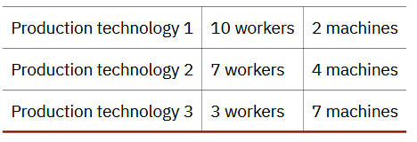

## Choice of Production Technology

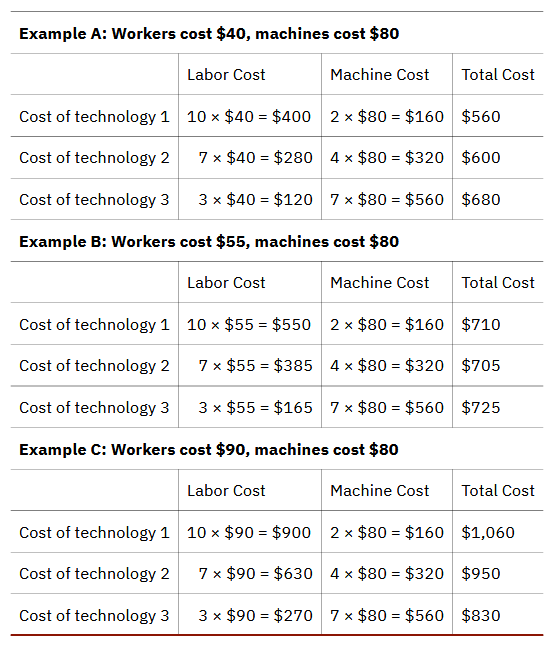

## Costs in the Long Run

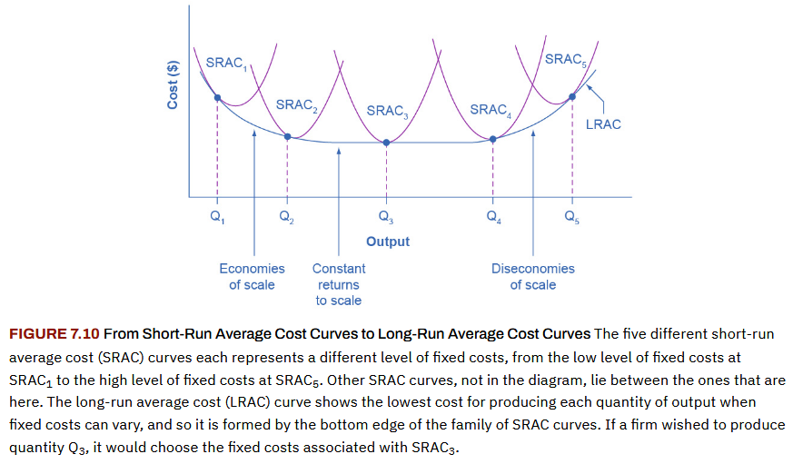

## Introduction to Perfect Competition

- Did you ever babysit, deliver newspapers, or mow lawns for money?  
  - If so, you probably faced **many competitors offering identical services**.  
  - There was nothing preventing others from entering the market, and most of you charged the **going rate**.  
  - If you tried to charge more, customers could simply turn to someone else.

## Introduction to Perfect Competition

- A **perfectly competitive market** is an idealized case—but some industries come close. 
- Firms in these markets face many competitors selling nearly identical goods and must act as **price takers**. 
- Economists often use **agricultural markets** as a classic example.

## Perfect Competition
### Core Idea

- A perfectly competitive firm is a **price taker** because intense competition forces it to accept the **market equilibrium price**.  
  - If a firm raises its price even slightly, it will lose all sales to competitors.

- The **market supply and demand** together determine price — **not the actions of any single firm**. 
 - Each firm is such a small part of the overall market that changing its own output does **not affect the market price**.

## Perfect Competition
### Key Conditions

- Firms operate under **perfect competition** when the following hold:
  - **Many firms** produce identical products.  
  - **Many buyers and sellers** participate in the market.  
  - **Full information** exists—buyers and sellers know all relevant details.  
  - **Free entry and exit**—firms can enter or leave the market without barriers.

## Perfect Competition
### Profit Maximization

A perfectly competitive firm has one major decision to make: **how much to produce**.  

Profit is defined as:

$$
\pi = TR - TC = P \times Q - AC \times Q = (P - AC)Q
$$


## Perfect Competition
### Profit Maximization

- Because the firm must accept the **market price**, it cannot set its own.  
  - It can sell **any quantity at that price**, meaning it faces a **perfectly elastic demand curve**.  

- When the firm chooses its output level, this quantity (combined with market prices for output and inputs) determines its **total revenue**, **total costs**, and therefore **profit**.

## Perfect Competition

<div style="font-size: 0.9em;">

```{r}
#| echo: false

x <- data.frame(
  Q = seq(0, 120, 10)
)
x$TR <- x$Q * 4
x$TC = c(62, 90, 110, 126, 138, 150, 165, 190, 230, 296, 400, 550, 715)
x$profit <- ""
knitr::kable(
  x[1:10, ],
)

```

## Perfect Competition

<div style="font-size: 0.9em;">

```{r}
#| echo: false

x$profit <- x$TR - x$TC
knitr::kable(
  x[1:10, ],
)

```

## Perfect Competition

```{r}
#| echo: false

par(mar = c(4.5, 4.5, 1, 1))
plot(x$Q, x$TR, type = "l",
     col = "blue", lwd = 4,
     ylab = "Dollars ($)", xlab = "Quantity",
     cex.lab = 1.5, cex.axis = 1.25,
     ylim = c(min(x$profit), max(x$TC)))
abline(h = 0, lty = 2, col = "grey", lwd = 4)
lines(x$Q, x$TC, lwd = 4, col = "red")
lines(x$Q, x$profit, lwd = 4, col = "green")
legend("topleft",
       legend = c("Revenue", "Cost", "Profit"),
       col = c("blue", "red", "green"), bty = 'n',
       cex = 1.25, lwd = 2)

```

## Perfect Competition

```{r}
#| echo: false

par(mar = c(4.5, 4.5, 1, 1))
plot(x$Q, x$TR, type = "l",
     col = "blue", lwd = 4,
     ylab = "Dollars ($)", xlab = "Quantity",
     cex.lab = 1.5, cex.axis = 1.25,
     ylim = c(min(x$profit), max(x$TC)))
abline(h = 0, lty = 2, col = "grey", lwd = 4)
lines(x$Q, x$TC, lwd = 4, col = "red")
lines(x$Q, x$profit, lwd = 4, col = "green")
legend("topleft",
       legend = c("Revenue", "Cost", "Profit"),
       col = c("blue", "red", "green"), bty = 'n',
       cex = 1.25, lwd = 2)

prof_idx <- which(x$profit >= 0)
q_prof  <- x$Q[prof_idx]
TR_prof <- x$TR[prof_idx]
TC_prof <- x$TC[prof_idx]
polygon(
  x = c(q_prof, rev(q_prof)),
  y = c(TR_prof, rev(TC_prof)),
  col = rgb(0, 1, 0, 0.25),
  border = NA
)

loss_idx <- which(x$profit <= 0)

runs <- split(loss_idx, cumsum(c(1, diff(loss_idx) != 1)))

for (r in runs) {
  q_loss  <- x$Q[r]
  TR_loss <- x$TR[r]
  TC_loss <- x$TC[r]
  
  polygon(
    x = c(q_loss, rev(q_loss)),
    y = c(TR_loss, rev(TC_loss)),
    col = rgb(1, 0, 0, 0.25),
    border = NA
  )
}

```

## Perfect Competition

```{r}
#| echo: false

par(mar = c(4.5, 4.5, 1, 1))
plot(x$Q, x$TR, type = "l",
     col = "blue", lwd = 4,
     ylab = "Dollars ($)", xlab = "Quantity",
     cex.lab = 1.5, cex.axis = 1.25,
     ylim = c(min(x$profit), max(x$TC)))
abline(h = 0, lty = 2, col = "grey", lwd = 4)
lines(x$Q, x$TC, lwd = 4, col = "red")
lines(x$Q, x$profit, lwd = 4, col = "green")
legend("topleft",
       legend = c("Revenue", "Cost", "Profit"),
       col = c("blue", "red", "green"), bty = 'n',
       cex = 1.25, lwd = 2)
segments(80, -1000, 80, x$TR[x$Q == 80], lty = 2)
text(70, -100, "q* = 80")

```

## Perfect Competition

<div style="font-size: 0.9em;">

```{r}
#| echo: false

x$MC <- x$MR <- ""
knitr::kable(
  x[1:10, ],
)

```

## Perfect Competition

<div style="font-size: 0.9em;">

```{r}
#| echo: false

x$MR <- c(NA, diff(x$TR)) / 10
x$MC <- c(NA, diff(x$TC)) / 10

knitr::kable(
  x[1:10, ],
)

```


## Perfect Competition

```{r}
#| echo: false

par(mar = c(4.5, 4.5, 1, 1))
plot(x$Q, x$MC, type = "l", lwd = 4,  col = "red",
     ylab = "Dollars ($)", xlab = "Quantity",
     cex.lab = 1.5, cex.axis = 1.25)
abline(h = 4, lwd = 4, col = "blue")
segments(80, 0, 80, x$MR[x$Q == 80], lty = 2)
text(95, 2, "q* = 80")
legend("topleft",
       legend = c("MR = P = D", "MC"),
       lwd = 2, col = c("blue", "red"),
       bty = "n", cex = 1.25)

```

## Perfect Competition

<div style="font-size: 0.9em;">

```{r}
#| echo: false

x$marginal_profit <- ""
knitr::kable(
  x[1:10, ],
)

```

## Perfect Competition

<div style="font-size: 0.9em;">

```{r}
#| echo: false

x$marginal_profit <- c(NA, diff(x$profit)) / 10
knitr::kable(
  x[1:10, ],
)

```

## Perfect Competition

```{r}
#| echo: false

par(mar = c(4.5, 4.5, 1, 1))
plot(x$Q, x$MC, type = "l", lwd = 4,  col = "red",
     ylab = "Dollars ($)", xlab = "Quantity",
     cex.lab = 1.5, cex.axis = 1.25)
abline(h = 4, lwd = 4, col = "blue")
segments(80, 0, 80, x$MR[x$Q == 80], lty = 2)
text(95, 2, "q* = 80")
legend("topleft",
       legend = c("MR = P = D", "MC"),
       lwd = 2, col = c("blue", "red"),
       bty = "n", cex = 1.25)

prof_idx <- which(x$marginal_profit >= 0)
q_prof  <- x$Q[prof_idx]
MR_prof <- x$MR[prof_idx]
MC_prof <- x$MC[prof_idx]
polygon(
  x = c(q_prof, rev(q_prof)),
  y = c(MR_prof, rev(MC_prof)),
  col = rgb(0, 1, 0, 0.25),
  border = NA
)

loss_idx <- which(x$marginal_profit <= 0)
q_loss  <- x$Q[loss_idx]
MR_loss <- x$MR[loss_idx]
MC_loss <- x$MC[loss_idx]
polygon(
  x = c(q_loss, rev(q_loss)),
  y = c(MC_loss, rev(MR_loss)),
  col = rgb(1, 0, 0, 0.25),
  border = NA
)

```
## Perfect Competition

<div style="font-size: 0.9em;">

```{r}
#| echo: false

x$AC <- ""
knitr::kable(
  x[1:10, ],
)

```

## Perfect Competition

<div style="font-size: 0.9em;">

```{r}
#| echo: false


x$AC <- round(x$TC / x$Q, 2)
x$AC[1] <- NA
knitr::kable(
  x[1:10, ],
)

```

## Perfect Competition
### Profit

```{r}
#| echo: false

minz <- min(c(x$AC, x$MC), na.rm = T)
maxz <- max(c(x$AC, x$MC), na.rm = T)

par(mar = c(4.5, 4.5, 1, 1))

plot(x$Q, x$AC, type = "l", lwd = 4, col = "orange", ylim = c(minz, maxz),
     ylab = "Dollars ($)", xlab = "Quantity",
     cex.lab = 1.5, cex.axis = 1.25)
lines(x$Q, x$MC, lwd = 4, col = "red")
abline(h = 4, lwd = 4, col = "blue")
segments(80, 0, 80, x$MR[x$Q == 80], lty = 2)
text(95, 2, "q* = 80")
legend("topleft",
       legend = c("MR = P = D", "MC", "AC"),
       lwd = 2, col = c("blue", "red", "orange"),
       bty = "n", cex = 1.25)

prof_idx <- 1:9
q_prof  <- x$Q[prof_idx]
MR_prof <- rep(4, length(q_prof))
AC_prof <- rep(x$AC[x$Q == 80], length(q_prof))
polygon(
  x = c(q_prof, rev(q_prof)),
  y = c(MR_prof, rev(AC_prof)),
  col = rgb(0, 1, 0, 0.25),
  border = NA
)

```

## Perfect Competition
### Break-even

```{r}
#| echo: false

x$TR <- x$Q * 2.5
x$profit <- x$TR - x$TC
x$MR <- c(NA, diff(x$TR)) / 10

minz <- min(c(x$AC, x$MC), na.rm = T)
maxz <- max(c(x$AC, x$MC), na.rm = T)

par(mar = c(4.5, 4.5, 1, 1))
plot(x$Q, x$AC, type = "l", lwd = 4, col = "orange", ylim = c(minz, maxz),
     ylab = "Dollars ($)", xlab = "Quantity",
     cex.lab = 1.5, cex.axis = 1.25)
lines(x$Q, x$MC, lwd = 4, col = "red")
abline(h = 2.5, lwd = 4, col = "blue")

segments(70, 0, 70, x$MR[x$Q == 70], lty = 2)
text(85, 1.5, "q* = 70")
legend("topleft",
       legend = c("MR = P = D", "MC", "AC"),
       lwd = 2, col = c("blue", "red", "orange"),
       bty = "n", cex = 1.25)

```

## Perfect Competition
### Loss

```{r}
#| echo: false

x$TC <- x$TC + 30
x$profit <- x$TR - x$TC
x$MC <- c(NA, diff(x$TC)) / 10
x$AC <- x$TC / x$Q
x$AC[1] <- NA

minz <- min(c(x$AC, x$MC), na.rm = T)
maxz <- max(c(x$AC, x$MC), na.rm = T)

par(mar = c(4.5, 4.5, 1, 1))
plot(x$Q, x$AC, type = "l", lwd = 4, col = "orange", ylim = c(minz, maxz),
     ylab = "Dollars ($)", xlab = "Quantity",
     cex.lab = 1.5, cex.axis = 1.25)
lines(x$Q, x$MC, lwd = 4, col = "red")
abline(h = 2.5, lwd = 4, col = "blue")

segments(70, 0, 70, x$AC[x$Q == 70], lty = 2)
text(85, 1.5, "q* = 70")
legend("topleft",
       legend = c("MR = P = D", "MC", "AC"),
       lwd = 2, col = c("blue", "red", "orange"),
       bty = "n", cex = 1.25)


q_loss  <- x$Q[x$Q <= 70]
MR_loss <- rep(2.5, length(q_loss))
AC_loss <- rep(x$AC[x$Q == 70], length(MR_loss))
polygon(
  x = c(q_loss, rev(q_loss)),
  y = c(MR_loss, rev(AC_loss)),
  col = rgb(1, 0, 0, 0.25),
  border = NA
)

```

## Perfect Competition
### Entry and Exit

- Firms **enter or exit** the market in response to **profit opportunities**.  
- While no individual firm can influence the **market price**, the **collective entry or exit** of many firms affects overall **market supply**.  
  - A change in total market supply shifts the **market price**, which in turn alters **profitability** for all firms.

## Perfect Competition
### Long-Run Equilibrium

- When **profits exist**, new firms enter — like **sharks drawn to blood** — increasing market supply and **driving prices down**.  
  - This process continues until prices fall to the point where $P = AC \implies \pi = 0$

- In **long-run equilibrium**, no firm has an incentive to enter or exit.  
  - All firms earn **zero economic profit** and produce where $P = MR = MC = AC$ since **MC** intersects **AC** at its **minimum point**.

## Perfect Competition
### Long-Run Adjustment

- In the **short run**, firms may earn **profits or losses**.  
  - **Profits** attract entry, pushing prices **down** to the zero-profit level.  
  - **Losses** lead to exit, reducing supply and pushing prices **up** to the zero-profit level.  

- In the **long run**, all firms that remain operate at the **lowest possible cost** with $\pi = 0$  ensuring **no incentive to enter or leave** the market.

<!-- ## Perfect Competition -->
<!-- ### Long-run Equilibirum -->

<!-- 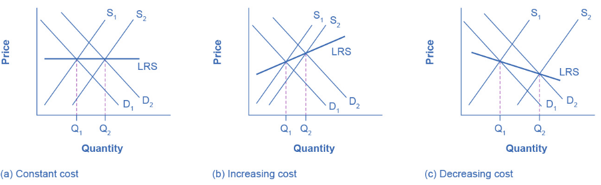 -->

## Monopoly
### Introduction

- A **monopoly** is a market with **no competition**, giving the firm substantial **market power**.  
  - A single firm produces **all output** in the market.  
  - Since it faces **no direct rivals**, it can set prices subject only to the **demand curve**.  

- Although a monopoly strictly means one producer, the term is often used more loosely to describe markets dominated by a **single firm with very high market share**.

## Monopoly
### Market Share

- A firm is considered a **monopoly** when it produces a product with **no close substitutes**.  
  - If consumers can choose among several **similar alternatives**, even if not identical, the market is **not truly monopolized**.  
  - However, determining what counts as a *close substitute* is often **subjective and debated**, making the boundaries of monopoly power **difficult to define in practice**.

## Monopoly
### Barriers to Entry

- Because monopolies face **no competition**, they can earn **sustained economic profits**.  
  - In a competitive market, such profits would attract entry—but monopolies persist because of **barriers to entry**.

- **Barriers to entry** are legal, technological, or market conditions that **prevent or discourage potential competitors**.  
  - These barriers can range from modest (e.g., **high startup costs**) to extreme (e.g., **exclusive control of scarce resources**).  
  - For instance, only a **limited number of radio frequencies** exist; once a firm owns all of them, new entrants are effectively blocked.
  
## Monopoly

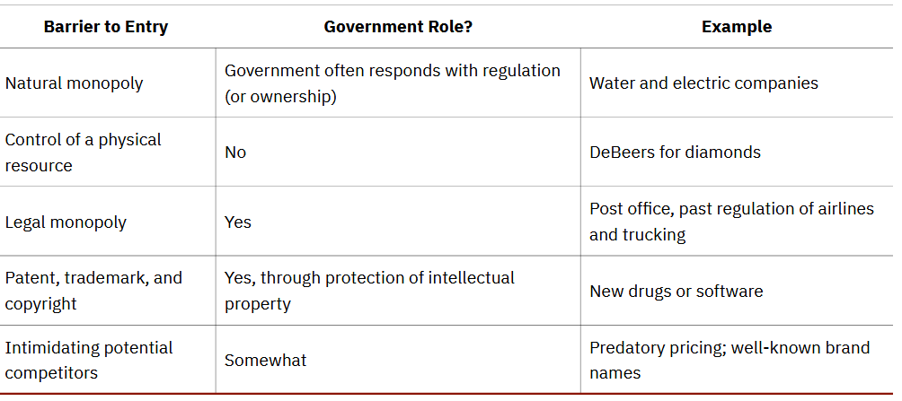

## Monopoly
### Natural Monopoly

- A **natural monopoly** arises when **economies of scale** are large relative to **market demand**.  
  - Once the **fixed costs** of infrastructure are in place, the **marginal cost** of serving additional customers is very low.  
  - As a result, **one firm** can produce the entire market output **more efficiently** than several smaller firms duplicating investments.

## Monopoly
### Natural Monopoly: Examples

- Once a **water utility** installs main pipes, the cost of connecting one more home is minimal.  
- Similarly, after an **electric company** installs lines, serving additional homes is cheap.  
- A second firm entering either market would have to duplicate infrastructure—an inefficient use of resources.

## Monopoly
### Local Market Example

- Natural monopolies can also occur in **smaller regional markets** where products are **costly to transport**.  
  - For example, **cement plants** experience economies of scale, but **transporting cement** long distances is expensive.  
  - In areas without access to water transport, a **single cement plant** may efficiently serve the entire local market.

## Monopoly
### Natural Monopoly

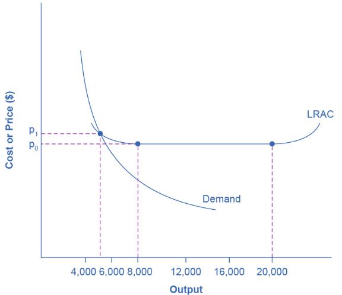

## Monopoly
### Economies of Scale and Market Size

- **Economies of scale** combined with **market size** can naturally restrict competition.  
- The long-run average cost (LRAC) curve for airplane manufacturing:  
  - Shows **economies of scale** up to about **8,000 planes per year** at price $P_0$  
  - Then **constant returns to scale** from 8,000–20,000 planes  
  - And **diseconomies of scale** beyond 20,000 planes

## Monopoly
### Natural Monopoly

- The **market demand curve** intersects the LRAC at about **5,000 planes per year** and a price $P_1 > P_0$. 
  - This means the market can support only **one efficient producer**.  
  - If a second firm entered producing 4,000 planes, its **average cost** would exceed that of the incumbent—making it uncompetitive.  
  - If it entered at 8,000 planes to lower costs, it would face **insufficient demand** to sell its output.

## Monopoly
### Promoting Innovation

- Suppose a company invests heavily in research and development and discovers a **cure for the common cold**.
  - In a world where information spreads instantly, other firms could copy the formula and sell the same drug at a lower price—since they didn’t bear the R&D costs.  
  - If this happened, few firms would have an incentive to invest in research, leading to **less innovation overall**.
  
- **Intellectual property law** grants creators temporary or exclusive rights over their ideas, inventions, and brands—providing incentives for innovation while eventually allowing competition.

## Monopoly
### Legal Monopolies & Intellectual Property

- **Patents** give inventors the exclusive right to make, use, or sell an invention (usually **20 years**) so they can recover R&D costs before rivals enter the market.  
- **Trademarks** protect distinctive names or symbols that identify products—like **Chiquita**, **Chevrolet**, or the **Nike swoosh**.  
- **Copyrights** safeguard original works such as books, music, and art for the **author’s life plus 70 years**.  
- **Trade secrets** protect confidential business information—like the **Coca-Cola formula**—without requiring public disclosure.

## Monopoly
### Deregulation

- For decades, some monopolies were **legally protected** due to technological or logistical limits.  
  - For example, **AT&T** was once the only company allowed to provide both local and long-distance telephone service.  
  - From the 1930s to 1970s, federal regulations also restricted **airline routes and fares**, **bank interest rates**, and **trucking prices**.
  - As technology evolved, these monopolies became harder to justify.  

## Monopoly

```{r}
#| echo: false

x <- data.frame(
  q = 0:8,
  p = seq(1300, 500, -100)
)
x$tr <- x$q * x$p
x$tc <- c(250, 500, 750, 1000, 1250, 1650, 2500, 4000, 6400)

knitr::kable(
  x[1:7, ],
)

```

## Monopoly

```{r}
#| echo: false

par(mar = c(4.5, 4.5, 1, 1))
plot(x$q, x$p, type = "l", lwd = 4,
     ylab = "Price", xlab = "Quantity",
     cex.lab = 1.5, cex.axis = 1.25)
text(8, 600, "D")

```

## Monopoly

```{r}
#| echo: false

x$profit <- x$tr - x$tc
knitr::kable(
  x[1:7, ],
)

```

## Monopoly

```{r}
#| echo: false

par(mar = c(4.5, 4.5, 1, 1))
plot(x$q, x$profit, type = "l", lwd = 4, col = "green",
     ylab = "Profit", xlab = "Quantity",
     cex.lab = 1.5, cex.axis = 1.25)
abline(h = 0, lty = 2, col = "grey", lwd = 4)
segments(5, min(x$profit)*10, 5, x$profit[x$q == 5], lty = 2, lwd = 4)
text(4.75, -2000, "q*")

```

## Monopoly

```{r}
#| echo: false

x$mr <- c(NA, diff(x$tr))
x$mc <- c(NA, diff(x$tc))
x$ac <- x$tc / x$q
knitr::kable(
  round(x[2:7, ]),
)

```

## Monopoly

```{r}
#| echo: false

y <- x[-1,]
y <- y[1:6,]

minz <- min(apply(y[,6:8], 2, min))
maxz <- max(apply(y[,6:8], 2, max))

par(mar = c(4.5, 4.5, 1, 1))
plot(y$q, y$p, type = "l",
     ylab = "Price", xlab = "Quantity",
     cex.lab = 1.5, cex.axis = 1.25,
     col = "blue", lwd = 4,
     ylim = c(minz, maxz))
lines(y$q, y$mr, lwd = 4, lty = 2, col = "blue")
lines(y$q, y$mc, lwd = 4, lty = 2, col = "red")
lines(y$q, y$ac, lwd = 4, col = "red")
legend("topright",
       legend = c("D", "MR", "AC", "MC"),
       col = c("blue", "blue", "red", "red"),
       lwd = 2, lty = c(1, 2, 1, 2), bty = "n")

```

## Monopoly

```{r}
#| echo: false

par(mar = c(4.5, 4.5, 1, 1))
plot(y$q, y$p, type = "l",
     ylab = "Price", xlab = "Quantity",
     cex.lab = 1.5, cex.axis = 1.25,
     col = "blue", lwd = 4,
     ylim = c(minz, maxz))
lines(y$q, y$mr, lwd = 4, lty = 2, col = "blue")
lines(y$q, y$mc, lwd = 4, lty = 2, col = "red")
lines(y$q, y$ac, lwd = 4, col = "red")
legend("topright",
       legend = c("D", "MR", "AC", "MC"),
       col = c("blue", "blue", "red", "red"),
       lwd = 2, lty = c(1, 2, 1, 2), bty = "n")
segments(5, 0, 5, y$p[y$q == 5], lty = 2, lwd = 4)
segments(0, y$p[y$q == 5], 5, y$p[y$q == 5], lty = 2, lwd = 4)
segments(0, y$ac[y$q == 5], 5, y$ac[y$q == 5], lty = 2, lwd = 4)

polygon(
  x = c(0:5, rev(0:5)),
  y = c(rep(x$p[x$q == 5], 6), rev(rep(x$ac[x$q == 5], 6))),
  col = rgb(0, 1, 0, 0.25),
  border = NA
)
```

## Monopoly
### Allocative Efficiency

- While monopolies are often criticized for charging **high prices**, economists focus on their failure to produce the **socially optimal quantity** of output.  
  - Unlike perfectly competitive markets, monopolies restrict production to maximize profit, leading to **allocative inefficiency**—too little output from society’s perspective.  

- Allocative efficiency occurs when the **marginal benefit to society** from one more unit of a good **equals its marginal cost**, ensuring that resources are used where they generate the greatest overall value.

## Imperfect Competition

- Most real-world firms operate **between the extremes** of perfect competition and monopoly.  
  - These firms face **some market power** — they can influence the price they charge — but **not complete control**. 
  
- Their behavior depends on how many competitors exist and how differentiated their products are.

## Imperfect Competition
### Monopolistic Competition

- A **monopolistically competitive market** features **many firms** competing to sell products that are **similar but not identical**.  
  - Each firm offers a **distinctive product**, giving it some control over price.
  - Examples include clothing retailers, restaurants, grocery stores, or even products like **golf balls** and **beer**, which differ through branding, advertising, and consumer perception.  

- Monopolistic competition blends features of both **competition** and **monopoly** - many sellers, but each with a mini-monopoly over its own variety.

## Imperfect Competition
### Oligopoly

- An **oligopoly** is a market dominated by **a small number of large firms**.  
  - Example: **Boeing and Airbus** together produce nearly all large commercial aircraft worldwide.  
  - Example: The **soft drink industry**, led by **Coca-Cola and Pepsi**.  

- Key features:  
  - **High barriers to entry**  
  - **Strategic interdependence** — firms consider how rivals will react to their output and pricing decisions.

## Imperfect Competition
### Differentiated Products

- **Product differentiation** can occur through:
  - **Physical features:** e.g., *nonstick coating, extra spicy flavor, redesigned for comfort*  
  - **Location:** proximity to consumers or key suppliers (e.g., a gas station at a busy intersection)  
  - **Intangible aspects:** guarantees, reputation, free delivery, financing options  
  - **Perception:** branding and advertising create psychological differences among otherwise similar products  

## Imperfect Competition

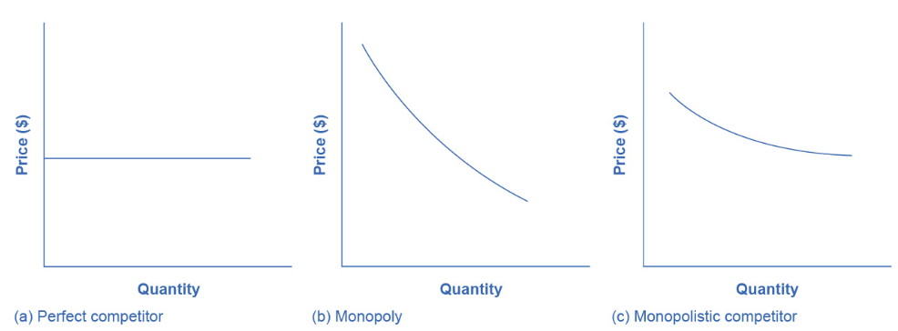

## Imperfect Competition

```{r}
#| echo: false

x <- data.frame(
  q = seq(10, 80, 10),
  p = rev(seq(8, 22, 2))
)
x$tr <- x$q * x$p
x$mr <- c(x$tr[1], diff(x$tr))/10
x$tc <- c(340, 400, 480, 580, 700, 840, 1020, 1280)
x$mc <- c(x$tc[1]/x$q[1], diff(x$tc))/10
x$ac <- x$tc / x$q

knitr::kable(
  round(x, 1),
)

```

## Imperfect Competition

```{r}
#| echo: false

par(mar = c(4.5, 4.5, 1, 1))
plot(x$q, x$p, lwd = 4, type = "l", col = "blue",
     ylim = c(2, 22), ylab = "Price",
     xlab = "Quantity", 
     cex.lab = 1.5, cex.axis = 1.25)
lines(x$q, x$mr, lwd = 4, lty = 2, col = "blue")
lines(x$q, x$ac, lwd = 4, col = "red")
lines(x$q[x$q > 10], x$mc[x$q > 10], lwd = 4, lty = 2, col = "red")
q_star <- max(x$q[x$mr >= x$mc])
segments(q_star, 0, q_star, x$p[x$q == q_star], lty = 2, lwd = 2)
segments(0, x$p[x$q == q_star], q_star, x$p[x$q == q_star], lty = 2, lwd = 2)
segments(0, x$ac[x$q == q_star], q_star, x$ac[x$q == q_star], lty = 2, lwd = 2)
qs <- x$q[x$q <= q_star]
qs <- c(0, qs)
ps <- x$p[x$q == q_star]
ps <- rep(ps, length(qs))
as <- x$ac[x$q == q_star]
as <- rep(as, length(qs))
polygon(
  x = c(qs, rev(qs)),
  y = c(ps, rev(as)),
  col = rgb(0, 1, 0, 0.25),
  border = NA
)
legend("bottomright",
       legend = c("D", "MR", "AC", "MC"),
       col = c("blue", "blue", "red", "red"),
       lwd = 2, lty = c(1, 2, 1, 2), bty = "n")

```

## Imperfect Competition
### Entry and Exit

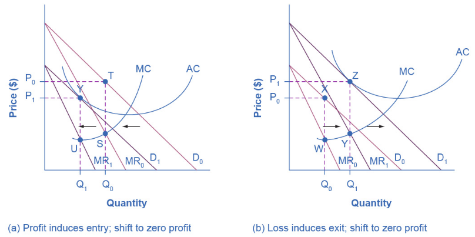

## Imperfect Competition
### Increased Competition (p - 2)

```{r}
#| echo: false

x <- data.frame(
  q = seq(10, 80, 10),
  p = rev(seq(8, 22, 2))-2
)
x$tr <- x$q * x$p
x$mr <- c(x$tr[1], diff(x$tr))/10
x$tc <- c(340, 400, 480, 580, 700, 840, 1020, 1280)
x$mc <- c(x$tc[1]/x$q[1], diff(x$tc))/10
x$ac <- x$tc / x$q

knitr::kable(
  round(x, 1),
)

```

## Imperfect Competition

```{r}
#| echo: false

par(mar = c(4.5, 4.5, 1, 1))
plot(x$q, x$p, lwd = 4, type = "l", col = "blue",
     ylim = c(2, 22), ylab = "Price",
     xlab = "Quantity", 
     cex.lab = 1.5, cex.axis = 1.25)
lines(x$q, x$mr, lwd = 4, lty = 2, col = "blue")
lines(x$q, x$ac, lwd = 4, col = "red")
lines(x$q[x$q > 10], x$mc[x$q > 10], lwd = 4, lty = 2, col = "red")
q_star <- max(x$q[x$mr >= x$mc])
segments(q_star, 0, q_star, x$p[x$q == q_star], lty = 2, lwd = 2)
segments(0, x$p[x$q == q_star], q_star, x$p[x$q == q_star], lty = 2, lwd = 2)
segments(0, x$ac[x$q == q_star], q_star, x$ac[x$q == q_star], lty = 2, lwd = 2)

qs <- x$q[x$q <= q_star]
qs <- c(0, qs)
ps <- x$p[x$q == q_star]
ps <- rep(ps, length(qs))
as <- x$ac[x$q == q_star]
as <- rep(as, length(qs))

polygon(
  x = c(qs, rev(qs)),
  y = c(ps, rev(as)),
  col = rgb(0, 1, 0, 0.25),
  border = NA
)

legend("bottomright",
       legend = c("D", "MR", "AC", "MC"),
       col = c("blue", "blue", "red", "red"),
       lwd = 2, lty = c(1, 2, 1, 2), bty = "n")

```

## Imperfect Competition
### Monopolistic Competition and Efficiency

- In **perfect competition**, entry and exit push firms to produce at the
**minimum of AC**, achieving **productive efficiency**.  

- In **monopolistic competition**, entry and exit lead firms to produce on the **downward-sloping** portion of the AC curve (not at its minimum) so the market is **not productively efficient**.

## Imperfect Competition
### Monopolistic Competition and Efficiency

- Perfectly competitive firms produce where **P = MC**, achieving **allocative efficiency**.  

- Monopolistically competitive firms set **MR = MC**, but because demand slopes downward, **P > MR**, meaning **P > MC**.  
  - When **P > MC**, society values extra units more than they cost to produce, but the firm does not supply them.
  - The result is **allocative inefficiency** -- a higher price and lower quantity than under perfect competition.

## Imperfect Competition
### Benefits of Variety and Differentiation

- Although monopolistic competition lacks productive and allocative efficiency, it provides **variety**.
  - Consumers prefer differentiated options (different clothes, foods, services, and product features) over the uniformity implied by perfect competition. 
  - Firms compete through service, quality, features, and innovation.

## Imperfect Competition
### Benefits of Variety and Differentiation

- Debate persists over whether markets create **too much** or the **right amount** of variety.  
  - Critics argue that extensive differentiation and advertising can be **socially wasteful**.  
  - Defenders argue that consumers **choose variety**, and firms’ pursuit of profit drives meaningful innovation and choice.

- The “optimal” amount of variety is hard to define and depends on how one values consumer choice.

## Imperfect Competition
### Oligopoly

- Oligopoly firms face a strong temptation to act like a **monopoly**.
  - By coordinating, they can restrict output, raise prices, and share the resulting profits.  
  - Such coordinated behavior is called **collusion**.  

- A formal collusive agreement to set output and price like a monopoly is known as a **cartel**.

## Imperfect Competition
### Game Theory

- Oligopolies are **mutually interdependent**, so no single unified theory predicts their behavior. 

- Economists instead use **game theory**, which studies strategic decision-making where payoffs depend on others’ actions.  
  - Game theory has broad applications in economics, business, law, and military strategy.

## Imperfect Competition
### Prisoner's Dilemma

- The **prisoner’s dilemma** illustrates situations where cooperation yields higher gains than acting in self-interest.  
  - It maps well onto oligopoly: firms would benefit from cooperating, but each has an incentive to cheat.  
  
- The term comes from a classic scenario in economics and the social sciences, referring to scenarios where individuals are "prisoner" to their own best strategy.

## Imperfect Competition
### Prisoner's Dilemma

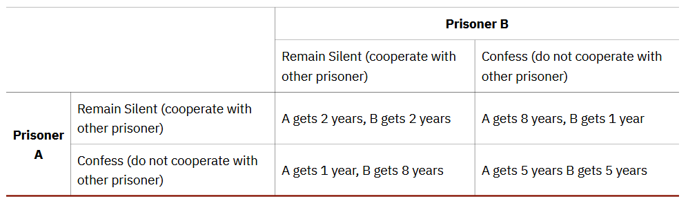

## Imperfect Competition
### Prisoner's Dilemma

```{=html}
<style type="text/css">
.tg  {border-collapse:collapse;border-spacing:0;}
.tg td{border-color:black;border-style:solid;border-width:1px;font-family:Arial, sans-serif;font-size:28px;
  overflow:hidden;padding:10px 5px;word-break:normal;}
.tg th{border-color:black;border-style:solid;border-width:1px;font-family:Arial, sans-serif;font-size:28px;
  font-weight:normal;overflow:hidden;padding:10px 5px;word-break:normal;}
.tg .tg-49iy{border-color:inherit;font-family:Georgia, serif !important;text-align:center;vertical-align:top}
</style>
<table class="tg"><thead>
  <tr>
    <th class="tg-49iy"></th>
    <th class="tg-49iy"></th>
    <th class="tg-49iy" colspan="2">Player B</th>
  </tr></thead>
<tbody>
  <tr>
    <td class="tg-49iy"></td>
    <td class="tg-49iy"></td>
    <td class="tg-49iy">Collude</td>
    <td class="tg-49iy">Compete</td>
  </tr>
  <tr>
    <td class="tg-49iy" rowspan="2"><br>Player<br>A<br></td>
    <td class="tg-49iy">Collude</td>
    <td class="tg-49iy">($1,000, $1000)</td>
    <td class="tg-49iy">($200, $1,500)</td>
  </tr>
  <tr>
    <td class="tg-49iy">Compete</td>
    <td class="tg-49iy">($1,500, $200)</td>
    <td class="tg-49iy">($400, $400)</td>
  </tr>
</tbody>
</table>
```

## Imperfect Competition
### Oligopoly

- When Oligopoly arises from **innovation** or **economies of scale**, it can benefit consumers by lowering costs or improving products.

- However, strong **barriers to entry** allow oligopolists to earn long-run profits and reduce pressure to innovate or provide high-quality service.  
  - Oligopolists also tend not to produce at the **minimum of AC**.

- The goal of eocnomic policy is to balance these realities.